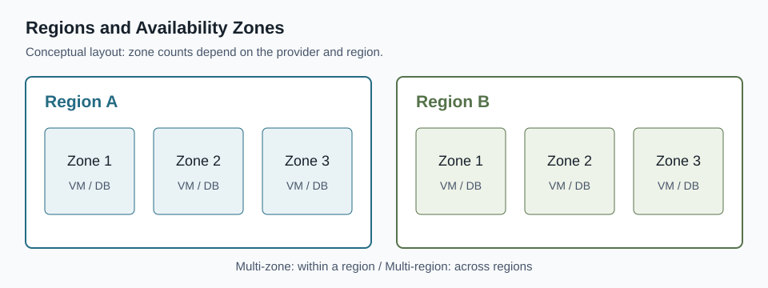
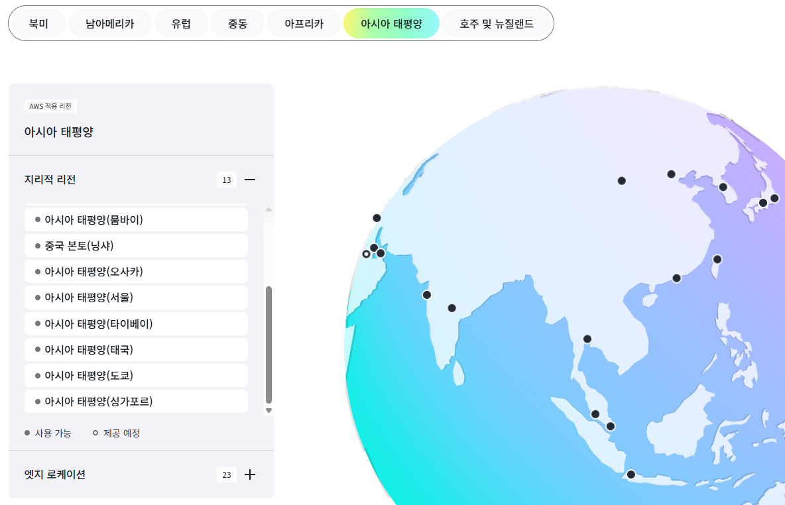
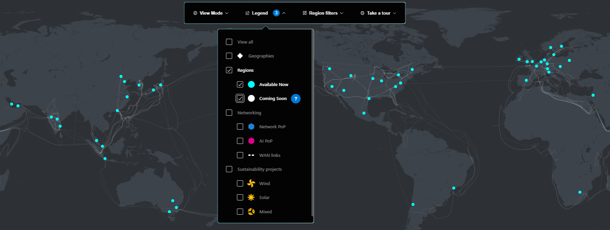
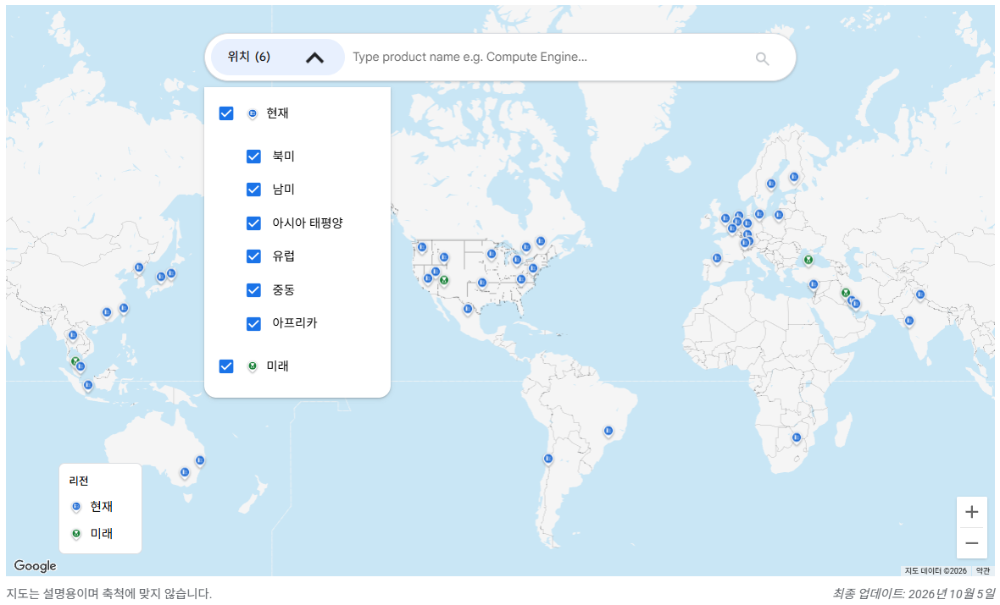
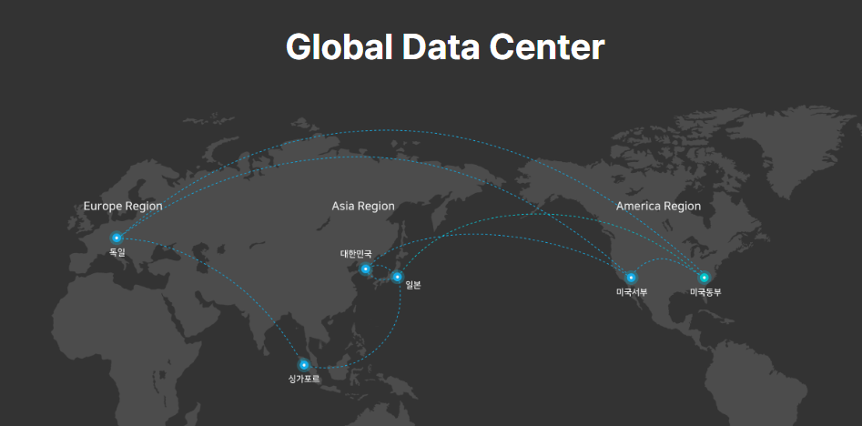

+++
title = 'AWS·Azure·GCP·네이버클라우드 리전 비교: 전 세계 어디에 배포할 수 있을까?'
date = '2026-10-16T00:00:00+09:00'
draft = false
slug = 'cloud-region-comparison'
description = 'AWS·Azure·GCP·네이버클라우드의 전 세계 리전 수와 권역별 분포, 한국 리전을 비교한다. 운영 목록과 개설 예정·별도 클라우드를 구분하고 리전과 가용 영역의 차이 및 선택 기준을 정리한다.'
tags = ['aws', 'azure', 'gcp', 'naver-cloud', 'region', 'availability-zone']
categories = ['IT개발']
showTableOfContents = true
+++

클라우드 서버를 한국·일본·미국에 각각 배포하려면 해당 CSP가 그 지역에 리전을 제공해야 한다. 전 세계 리전이 많더라도 필요한 국가에 없거나, 그 리전에서 사용하는 DB·VM 상품을 지원하지 않으면 배포 후보가 되지 못한다.

AWS·Azure·GCP·네이버클라우드의 **리전 수, 지역별 분포, 한국 리전**을 비교했다. 확인 기준일은 **2026년 10월 16일**이며, 공식 문서의 현재 목록을 집계한 값이다. 개설 예정·프리뷰 리전은 포함하지 않았다.

## 1. 전 세계 리전 수 비교


| CSP | 공식 소개 수치 | 본문 집계 | 집계 대상 | 한국 리전 |
| --- | ---: | ---: | --- | --- |
| AWS | 39개 | **34개** | 상용 AWS 리전 목록. 중국·GovCloud·European Sovereign Cloud 제외 | 서울 1개 |
| Azure | 70개 이상 | **57개** | Azure public cloud 목록에서 프리뷰 제외. 접근 제한 리전 포함 | 서울·부산 2개 |
| GCP | 43개 | **43개** | Compute Engine의 표준 존을 리전 코드로 묶어 집계 | 서울 1개 |
| NCP | 아래 사용 환경 표 기준 | **5개** | 일반 서비스의 공식 리전·존 표 | 한국 1개 |


**공식 소개 숫자와 본문 집계는 범위가 다르다.** 일반 서비스의 배포 위치를 비교하기 위해 별도 계정·운영 체계인 정부 전용·중국 별도 클라우드·주권 클라우드는 본문 집계에서 제외했다. CDN 엣지 거점, Local Zone, 데이터센터 건물 수도 리전 수에 더하지 않는다.

집계에 사용한 목록은 다음과 같다.

- **AWS:** [상용 AWS 리전 목록](https://docs.aws.amazon.com/global-infrastructure/latest/regions/aws-regions.html)의 34개다. 별도 계정·파티션으로 운영하는 범위는 제외했으므로 [글로벌 인프라 소개](https://aws.amazon.com/about-aws/global-infrastructure/)의 39개와 구분한다. [European Sovereign Cloud](https://aws.amazon.com/blogs/aws/opening-the-aws-european-sovereign-cloud/)도 별도 파티션이다. 사용 전 별도 활성화(Opt-in)가 필요한 상용 리전은 포함했다.
- **Azure:** [Azure regions list](https://learn.microsoft.com/en-us/azure/reliability/regions-list)의 **All 표 58개 중 프리뷰 리전인 Taiwan North를 제외한 57개**다. 해당 리전 아이콘의 대체 텍스트는 'coming soon'이지만, 표의 범례에서는 프리뷰 상태로 정의한다. 권역별 탭의 반복 행은 중복 집계하지 않았다. 포함된 57개 중 8개에는 접근 제한 표시가 있다. [공식 개요의 70개 이상](https://learn.microsoft.com/en-us/azure/reliability/regions-overview)은 이 집계값과 구분한다.
- **GCP:** [Compute Engine 리전·존 목록](https://docs.cloud.google.com/compute/docs/regions-zones)의 표준 존 130개를 리전 코드로 묶으면 43개다. [글로벌 위치 소개](https://cloud.google.com/about/locations)의 43개와 일치한다. 추가 AI 존이 생기더라도 이를 별도 리전으로 세지 않는다. 집계에는 이용 조건이 있는 리전도 포함한다. 예를 들어 사우디아라비아 외 청구 주소를 사용하는 고객이 담맘(`me-central2`)을 이용하려면 인보이스 결제(Invoiced Billing)가 필요하다. [담맘 리전 이용 조건](https://docs.cloud.google.com/docs/dammam-region-access)
- **NCP:** [사용 환경 개요의 리전·존 표](https://guide.ncloud-docs.com/docs/environment-environment-1-1)에 있는 한국·미국 서부·싱가포르·일본·독일 5개다. 과거 자료나 [전용회선 요금표](https://www.ncloud.com/charge/region/ko)에는 홍콩도 나오지만, 현재 리전·존 목록에는 없어 이번 집계에서 제외했다. 이를 근거로 종료 시점이나 사유까지 단정하지는 않는다.

이 표는 위 날짜에 확인한 **문서 목록의 스냅샷**이며, 신규 자원을 생성할 수 있는지는 해당 계정·구독의 콘솔에서 다시 확인해야 한다.

## 2. 리전과 가용 영역은 무엇이 다를까

**리전**(Region)은 서울·도쿄처럼 서비스를 배포할 지리적 범위다. **가용 영역**(Availability Zone, AZ)은 리전 안에서 장애 영향을 분리하도록 구성한 배포 단위다. GCP·NCP는 주로 존(Zone)이라는 명칭을 사용한다.

도식의 리전당 존 3개는 설명용이다. **모든 CSP의 모든 리전이 3개 AZ를 제공하는 것은 아니다.** AZ 하나를 데이터센터 건물 하나와 동일하게 보아서도 안 된다. AWS는 AZ가 하나 이상의 데이터센터로 구성된다고 설명한다. [AWS 리전·AZ 개념](https://docs.aws.amazon.com/global-infrastructure/latest/regions/aws-regions-availability-zones.html)

서울 리전의 서로 다른 AZ에 서버를 배치하는 것은 **멀티 AZ**, 서울과 도쿄 리전에 나누어 배치하는 것은 **멀티 리전**이다. 전자는 존 장애, 후자는 리전 전체 장애까지 고려하는 구성이다. 서버 배치 외에 DB 복제와 트래픽 전환도 따로 구성해야 한다. [GCP 리전·존과 장애 분리](https://docs.cloud.google.com/compute/docs/regions-zones)

## 3. 어느 지역에 리전이 많을까

앞의 본문 집계 대상을 권역별로 나눈 결과다. 아시아와 오세아니아를 분리하고, 중동은 별도 열로 묶었다. 북미에는 미국·캐나다·멕시코를 포함한다.


| CSP | 아시아 | 오세아니아 | 북미 | 남미 | 유럽 | 중동 | 아프리카 | 합계 |
| --- | ---: | ---: | ---: | ---: | ---: | ---: | ---: | ---: |
| AWS | 11 | 3 | 7 | 1 | 8 | 3 | 1 | **34** |
| Azure | 12 | 5 | 12 | 3 | 19 | 4 | 2 | **57** |
| GCP | 10 | 2 | 12 | 2 | 13 | 3 | 1 | **43** |
| NCP | 3 | 0 | 1 | 0 | 1 | 0 | 0 | **5** |


출처는 앞의 4사 리전 목록이다. GCP의 `europe-*` 등 리전 코드와 실제 위치, AWS의 Geography, Azure의 Physical location을 기준으로 분류했다. Azure의 Asia Pacific 탭 중 호주·뉴질랜드는 오세아니아로, Americas 탭 중 브라질·칠레는 남미로 분리했다. 접근 제한 리전도 첫 표와 동일하게 포함했다.

이 표에서 **0은 해당 권역 이용자에게 서비스할 수 없다는 뜻이 아니라, 집계 대상 목록에 현지 리전이 없다는 뜻**이다. 예를 들어 NCP로 오세아니아 이용자에게 서비스를 제공하려면 다른 권역의 리전에서 응답하게 된다. 이때 실제 이용자 네트워크에서 지연 시간을 측정해 배포 후보를 판단해야 한다.

### 공식 지도에서 분포 확인하기

지도는 배포 위치를 살펴보는 자료다. 개설 예정 리전이나 별도 클라우드, 데이터센터 거점까지 표시될 수 있어, 지도상의 점 개수를 앞의 집계값으로 사용하지 않았다.

**AWS 아시아 태평양**

이 화면에는 중국 본토 리전도 포함된다. 지도에 표시된 아시아 태평양 13개와 본문 집계의 아시아 11개는 범위가 다르며, 본문에서는 중국 리전을 제외했다. 호주·뉴질랜드는 별도 권역으로 분류했다.

**Azure 글로벌 리전**

청록색 원은 현재 이용 가능한 리전, 흰색 원은 개설 예정 리전이다. Geography·네트워크 PoP·에너지 프로젝트 등의 표시를 해제한 화면이며, 본문 집계에서는 개설 예정 리전을 제외했다.

**GCP 글로벌 리전**

현재·미래 리전이 함께 선택되어 있다. 파란색은 현재 리전, 초록색은 미래 리전이며, 본문의 43개는 현재 리전만 집계한 값이다. 메뉴의 `위치 (6)`은 선택한 권역 수이지 리전 수가 아니다.

**NCP 글로벌 데이터센터**

글로벌 데이터센터 분포도에는 미국 동부도 표시된다. 다만 앞서 집계한 공식 리전·존 목록에는 미국 동부가 없어, 이 글의 리전 수에서는 제외했다. 이 지도만으로 미국 동부의 존 구성이나 현재 VM 생성 가능 여부를 판단하지 않는다.

## 4. 한국 리전은 어떻게 구성되어 있을까


| CSP | 한국 리전 | 코드·표기 | 공식 목록의 AZ·존 | 확인할 차이 |
| --- | --- | --- | --- | --- |
| AWS | 서울 | `ap-northeast-2` | 4개 AZ | 상용 AWS 리전 목록에서 한국은 서울 1개 |
| Azure | 서울 | `koreacentral` | 3개 AZ | 사용하는 서비스의 AZ 지원도 별도 확인 |
| Azure | 부산 | `koreasouth` | N/A | 리전 2개와 리전별 AZ 지원은 별개 |
| GCP | 서울 | `asia-northeast3` | `a`·`b`·`c` 3개 존 | VM은 존 단위로 배치 |
| NCP | 한국 | 존: `KR-1`·`KR-2` | Classic·VPC에 2개 존 | 두 존을 한국 리전 2개로 세지 않음 |


출처: [AWS 리전 목록](https://docs.aws.amazon.com/global-infrastructure/latest/regions/aws-regions.html), [Azure 리전 목록](https://learn.microsoft.com/en-us/azure/reliability/regions-list), [GCP 서울 존 목록](https://docs.cloud.google.com/compute/docs/regions-zones), [NCP 리전·존 표](https://guide.ncloud-docs.com/docs/environment-environment-1-1).

한국 내 서로 다른 리전에 배포할 요구가 있다면 Azure의 서울·부산을 후보로 검토할 수 있다. 다만 두 리전에서 필요한 상품을 지원하는지, 구독에서 배포할 수 있는지부터 확인해야 한다. 같은 리전의 다른 AZ에 배치하는 것으로 그 요구를 대신하지 않는다.

## 5. 리전이 있어도 필요한 상품은 없을 수 있다

리전 목록 확인 다음에는 **사용할 상품의 리전·존 지원표**를 확인한다. VM을 만들 수 있다고 같은 지역에서 특정 GPU, 관리형 Kubernetes, DB 엔진까지 사용할 수 있는 것은 아니다.


| 필요한 자원 | 확인할 항목 |
| --- | --- |
| VM·GPU | 인스턴스 계열, GPU 모델, 존별 공급, 계정 할당량 |
| 관리형 DB | DB 엔진·버전, 고가용성 구성, 다른 리전으로의 복제 지원 |
| Kubernetes | 관리형 서비스 제공 여부, 노드용 VM, 멀티 AZ 지원 |
| 스토리지 | 저장 위치, 존·리전 간 복제 방식, 백업 저장 위치 |
| 네트워크 | 리전 간 연결, 인터넷 아웃바운드(이그레스)·리전 간 데이터 전송 요금 |


공식 확인 경로: [AWS 서비스별 리전 지원](https://aws.amazon.com/about-aws/global-infrastructure/regional-product-services/), [Azure 리전별 제품](https://azure.microsoft.com/en-us/explore/global-infrastructure/products-by-region/), [GCP 리전별 제품](https://cloud.google.com/about/locations#products-available-by-region), [NCP 한국 환경별 서비스](https://guide.ncloud-docs.com/docs/environment-environmentproducts).

NCP는 해외 리전의 플랫폼 차이도 확인해야 한다. 사용 환경 표에서 **한국·싱가포르·일본은 VPC 존을 안내하지만, 미국 서부·독일은 Classic 존을 안내**한다. 한국 VPC 구성을 해외 리전에도 그대로 만들 수 있다고 가정하면 안 된다.

## 6. 실제 배포 리전은 이렇게 고른다


| 요구 조건 | 선택 기준 |
| --- | --- |
| 한국 이용자 대상 서비스 | 한국 리전부터 검토하고 실제 접속 지연·사용할 상품·비용 확인 |
| 한국·일본 각각에서 빠른 응답 필요 | 두 국가의 배포 위치와 데이터 동기화 방식 검토. 단일 리전으로도 목표 응답 시간을 충족하는지 먼저 측정 |
| 특정 존 장애에도 서비스 유지 | 같은 리전의 여러 AZ와 애플리케이션·DB의 장애 전환 구성 검토 |
| 리전 장애 시 다른 지역에서 복구 | 다른 리전에 백업·복제본 배치. RPO·RTO와 복구 절차 검증 |
| 데이터의 국내 저장 필요 | 서버뿐 아니라 DB·백업·로그·복제 대상의 저장 위치와 서비스 약관 확인 |
| 해외 다운로드 트래픽이 많음 | 배포 리전과 CDN을 함께 검토하고 아웃바운드(이그레스)·복제 트래픽 비용 계산 |


RPO는 장애 시 허용할 데이터 손실 시간, RTO는 복구에 허용할 시간이다. 백업만 다른 리전에 두는 구성과, 서버·DB 복제본을 준비해 전환하는 구성은 복구 시간과 운영비가 다르다. [고가용성과 재해 복구·RPO·RTO 설명](https://learn.microsoft.com/en-us/azure/reliability/concept-business-continuity-high-availability-disaster-recovery)

**리전 수는 배포 후보의 범위를 보여주는 숫자다.** 최종 선택은 이용자 위치와 필요한 상품으로 후보를 줄인 뒤, 지연 시간·장애 대응·비용을 확인해서 결정한다. 국내 VM의 디스크·공인 IP·데이터 전송 요금은 [4사 VM 비용 비교](/posts/cloud-vm-cost-comparison/)에서 이어서 확인할 수 있다.
