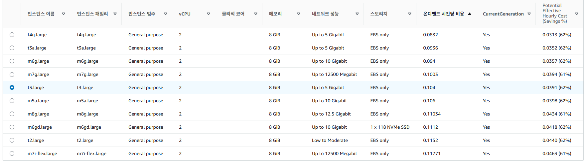
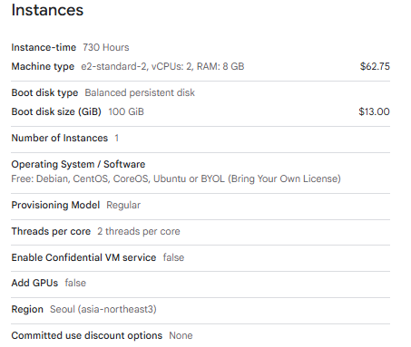
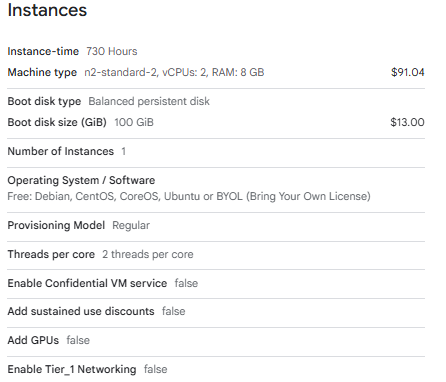
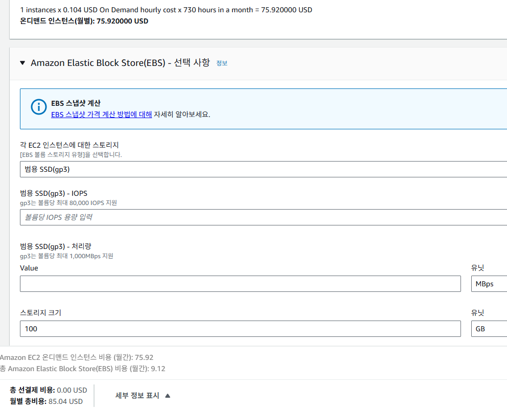
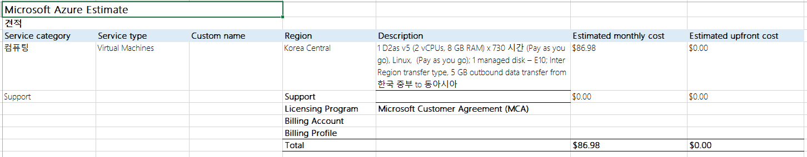
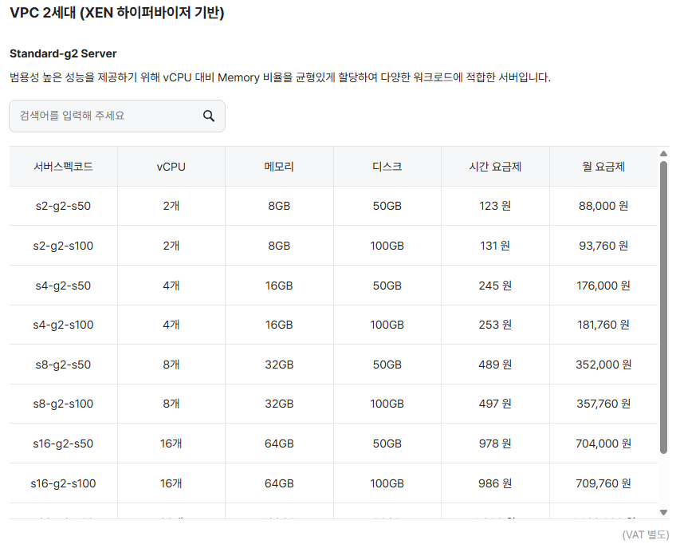
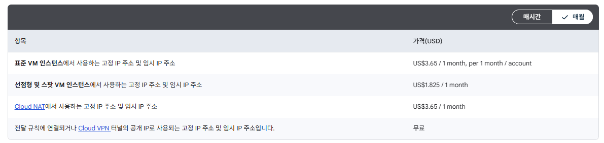
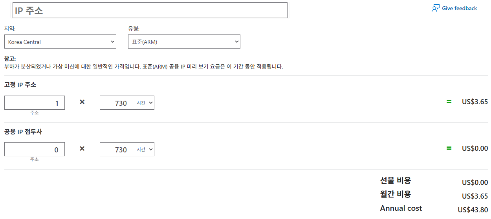
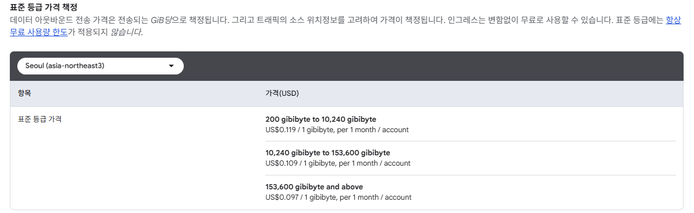
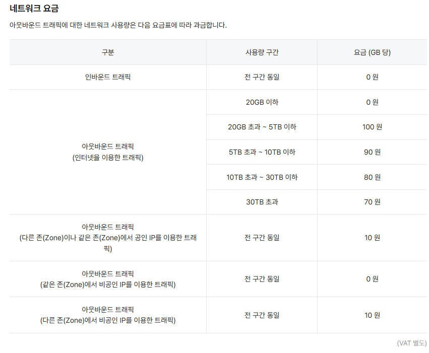

+++
title = 'GCP·AWS·Azure·네이버클라우드 VM 비용 비교: 서버 요금부터 이그레스까지'
date = '2026-10-12T00:00:00+09:00'
draft = true
slug = 'cloud-vm-cost-comparison'
description = '국내 리전의 2vCPU·8GB급 Linux VM 비용을 비교한다. GCP E2·N2, AWS T3·T3a·T4g, Azure B2as·D2as, 네이버클라우드 g2 SSD의 디스크·공인 IP 포함 유지비와 아웃바운드(이그레스) 트래픽별 월 비용을 계산한다.'
tags = ['gcp', 'aws', 'azure', 'naver-cloud', 'vm', 'cost']
categories = ['IT개발']
+++

2vCPU·메모리 8GB 서버를 한 달 운영하면 어느 클라우드가 저렴할까? VM 요금만으로는 답하기 어렵다. 디스크·공인 IP를 더하고 인터넷 아웃바운드(이그레스) 트래픽을 늘려보면 예상 비용이 달라진다.

GCP·AWS·Azure·네이버클라우드의 공식 계산기와 요금표를 확인하고, **VM·디스크·공인 IP의 기본 비용과 인터넷 데이터 전송 요금**을 나누어 계산했다. CPU 크레딧 적용 여부와 아키텍처가 다른 후보도 함께 정리했다. 실제 성능 측정이나 청구서 비교가 아닌 공개 요금에 따른 예산 예시다.

물리 서버 구매·임대까지 검토한다면 [서버호스팅 vs 클라우드 비용 비교](/posts/app-backend-server-cost-comparison/)를 참고한다.

## 비교 조건

가격 확인일은 **2026년 10월 16일**이다. 제공된 견적 캡처와 공식 가격표를 기준으로 계산했으며 실제 도입 시에는 같은 설정으로 다시 조회해야 한다.


| 항목 | 적용 조건 |
| --- | --- |
| 리전 | GCP 서울, AWS 서울, Azure Korea Central, NCP 한국 |
| 서버 | Linux VM 1대, 2vCPU·메모리 8GB급 |
| 사용 시간 | 월 730시간. 실제 청구 월의 시간 수와 구분하는 비교 가정 |
| VM 요금 | 시간당 온디맨드·종량제. 약정·Spot·가입 크레딧 제외 |
| 저장소 | GCP OS 100GiB, AWS OS 화면 표기 100GB, Azure OS E10 128GiB. NCP는 OS SSD 50GB + 추가 SSD 50GB |
| 공인 IP | 사용 중인 외부 IPv4 1개 |
| 트래픽 목적지 | 국내 이용자에게 인터넷으로 직접 전송 |
| 아웃바운드(이그레스) 트래픽 예시 | 각 CSP 요금표의 계량 단위로 월 100·500·1,024. GCP는 GiB, 나머지는 표기상 GB |
| 환율·세금 | $1 = 1,400원 가정, VAT 제외 |
| 별도 비용 | CPU 크레딧 추가 과금, 스토리지 트랜잭션·추가 성능, 백업·DB·LB·NAT Gateway·CDN·유료 지원·운영 인건비 |


**같은 성능의 서버를 비교하는 표는 아니다.** 메모리·디스크의 GB/GiB 표기, CPU 플랫폼과 할당 방식, 스토리지 성능이 다르다. 아웃바운드(이그레스) 트래픽 표도 각 공급사의 계량값을 넣은 예산 예시다. 동일한 파일을 정확히 같은 바이트 수만큼 전송한 요금 순위가 아니며, 확인되지 않은 GB의 바이트 정의를 임의로 통일하지 않았다.

USD 금액의 원화 환산은 비교용이다. 실제 원화 결제에는 공급사의 환율·통화별 가격 정책이 적용되며, GCP는 [해당 통화의 SKU 가격](https://cloud.google.com/products/compute/pricing)을 적용한다고 안내한다.

## 종합 비교표

**VM·디스크·공인 IPv4의 기본 유지비와 인터넷 데이터 전송 요금을 합산한 월 예산**이다. 금액은 $1 = 1,400원 가정, VAT 제외다. 트래픽별 각 셀에는 적용한 GB·GiB 단위와 총비용을 함께 표시했다.

GCP N2는 SUD 미적용이며, CPU 크레딧 추가 과금과 스토리지 트랜잭션 등은 제외다. NCP는 OS 50GB와 추가 데이터 볼륨 50GB 구성이다. 같은 성능·동일 바이트 전송의 최저가 순위가 아니라 상품별 비용 구조를 비교한다.


| CSP | VM·CPU 조건 | 디스크 구성 | 네트워크 | 기본비<br>(원/월) | 100GB·GiB<br>월 총비용 | 500GB·GiB<br>월 총비용 | 1,024GB·GiB<br>월 총비용 |
| --- | --- | --- | --- | ---: | ---: | ---: | ---: |
| <strong data-csp="gcp">GCP</strong> | E2 (x86)<br>크레딧 미적용 | Balanced 100GiB | Premium | **111,160원** | 100GiB<br>**137,760원** | 500GiB<br>**244,160원** | 1,024GiB<br>**383,544원** |
| <span data-csp="gcp">GCP</span> | E2 (x86)<br>크레딧 미적용 | Balanced 100GiB | Standard | **111,160원** | 100GiB<br>**111,160원** | 500GiB<br>**161,140원** | 1,024GiB<br>**248,438원** |
| <span data-csp="gcp">GCP</span> | N2 (x86)<br>크레딧 미적용 | Balanced 100GiB | Premium | **150,766원** | 100GiB<br>**177,366원** | 500GiB<br>**283,766원** | 1,024GiB<br>**423,150원** |
| <span data-csp="gcp">GCP</span> | N2 (x86)<br>크레딧 미적용 | Balanced 100GiB | Standard | **150,766원** | 100GiB<br>**150,766원** | 500GiB<br>**200,746원** | 1,024GiB<br>**288,044원** |
| <strong data-csp="aws">AWS</strong> | T3 (x86)<br>크레딧 적용 | gp3 100GB 표기 | 인터넷 | **124,166원** | 100GB<br>**124,166원** | 500GB<br>**194,726원** | 1,024GB<br>**287,160원** |
| <span data-csp="aws">AWS</span> | T3a (x86)<br>크레딧 적용 | gp3 100GB 표기 | 인터넷 | **113,540원** | 100GB<br>**113,540원** | 500GB<br>**184,100원** | 1,024GB<br>**276,534원** |
| <span data-csp="aws">AWS</span> | T4g (Arm)<br>크레딧 적용 | gp3 100GB 표기 | 인터넷 | **103,054원** | 100GB<br>**103,054원** | 500GB<br>**173,614원** | 1,024GB<br>**266,048원** |
| <strong data-csp="azure">Azure</strong> | B2as v2 (x86)<br>크레딧 적용 | E10 128GiB | Microsoft Premium | **114,212원** | 100GB<br>**114,212원** | 500GB<br>**181,412원** | 1,024GB<br>**269,444원** |
| <span data-csp="azure">Azure</span> | D2as v5 (x86)<br>크레딧 미적용 | E10 128GiB | Microsoft Premium | **126,882원** | 100GB<br>**126,882원** | 500GB<br>**194,082원** | 1,024GB<br>**282,114원** |
| <strong data-csp="ncp">NCP</strong> | g2 (x86)<br>크레딧 미적용 | OS SSD 50GB<br>+ SSD 50GB | 인터넷 | **99,718원** | 100GB<br>**107,718원** | 500GB<br>**147,718원** | 1,024GB<br>**200,118원** |


아래에서 각 견적의 구성과 무료 트래픽 적용 과정을 확인할 수 있다.

## 비교 대상 VM 사양


| CSP | 비교 상품 | CPU·아키텍처 | CPU 크레딧 |
| --- | --- | --- | --- |
| <strong data-csp="gcp">GCP</strong> | `e2-standard-2` | Intel 또는 AMD x86, 자동 선정 | 미적용 |
| <span data-csp="gcp">GCP</span> | `n2-standard-2` | Intel x86 | 미적용 |
| <strong data-csp="aws">AWS</strong> | `t3.large` | Intel x86 | 적용 |
| <span data-csp="aws">AWS</span> | `t3a.large` | AMD x86 | 적용 |
| <span data-csp="aws">AWS</span> | `t4g.large` | AWS Graviton2, Arm | 적용 |
| <strong data-csp="azure">Azure</strong> | `Standard_B2as_v2` | AMD x86 | 적용 |
| <span data-csp="azure">Azure</span> | `Standard_D2as_v5` | AMD x86 | 미적용 |
| <strong data-csp="ncp">NCP</strong> | `s2-g2-s50` + 추가 SSD 50GB | x86, g2 XEN 기반 | 미적용 |


**버스트 가능(Burstable) VM**은 CPU 크레딧을 사용해 기본 수준을 초과하는 CPU 성능을 낼 수 있는 VM이다. AWS 한국어 문서에서도 [‘버스트 가능 성능 인스턴스’](https://docs.aws.amazon.com/ko_kr/AWSEC2/latest/UserGuide/burstable-performance-instances.html)라는 표현을 사용한다.

AWS T3는 CPU를 적게 쓸 때 크레딧을 쌓고 기본 성능보다 많이 쓸 때 소모한다. `t3.large`의 기본 CPU 사용률은 30%이며, Unlimited에서는 장시간 부하에 따라 추가 CPU 요금이 발생할 수 있다. 반면 Azure B2as v2는 크레딧을 모두 쓰면 기본 CPU 성능으로 제한된다. **둘 다 버스트형이지만 크레딧 소진 후 동작이 같지는 않다.** [AWS T3](https://aws.amazon.com/ec2/instance-types/t3/), [AWS Unlimited](https://docs.aws.amazon.com/AWSEC2/latest/UserGuide/burstable-performance-instances-unlimited-mode-concepts.html), [Azure Basv2](https://learn.microsoft.com/en-us/azure/virtual-machines/sizes/general-purpose/basv2-series)

GCP `e2-standard-2`는 `e2-micro`·`e2-small`·`e2-medium` 같은 shared-core 상품과 다르다. 이름에 E2가 있다고 모두 CPU 버스트 상품으로 묶지 않는다. T4g는 사용하는 컨테이너 이미지·네이티브 라이브러리·실행 파일의 Arm 지원을 확인한 뒤 선택한다. [GCP E2](https://docs.cloud.google.com/compute/docs/general-purpose-machines#e2_machine_types), [AWS T4g](https://aws.amazon.com/ec2/instance-types/t4/)

AWS 후보 선택 화면에서도 같은 2vCPU·8GiB에 T3·T3a·T4g가 서로 다른 가격으로 표시된다. 네트워크의 ‘최대 5Gbps’가 같더라도 CPU 아키텍처와 성능 조건까지 같다는 뜻은 아니다.



확보한 견적에 맞춰 GCP·Azure는 각각 2종, AWS는 3종을 사용했다. NCP는 SSD가 포함된 g2 한 종을 사용한다. g1·HDD 상품이나 디스크 비용이 빠진 g3를 같은 조건으로 넣지 않았다.

## VM과 OS 디스크 비용

### GCP: E2와 N2

서울 `asia-northeast3`, Linux, 730시간, Balanced persistent disk 100GiB 구성이다.


| 항목 | E2 `e2-standard-2` | N2 `n2-standard-2` |
| --- | ---: | ---: |
| VM | $62.75 | $91.04 |
| Balanced 디스크 100GiB | $13.00 | $13.00 |
| VM + 디스크 | **$75.75** | **$104.04** |




N2 견적은 **지속 사용 할인(SUD)을 적용하지 않은 표시값**이다. 실제로 계속 운영하면 적용 대상 자원은 자동 할인 조건을 충족할 수 있으므로, 아래 N2 금액을 실제 청구액이라고 단정하면 안 된다. 이 글은 캡처의 할인 전 기준값을 유지한다. E2는 SUD 대상이 아니다. [GCP 지속 사용 할인](https://docs.cloud.google.com/compute/docs/sustained-use-discounts)



### AWS: T3·T3a·T4g

서울 `ap-northeast-2`, Linux, 공유 테넌시, VM 1대, 월 730시간의 온디맨드 구성이다. 디스크는 gp3이며 추가 IOPS·처리량 입력 없이 화면 표기 100GB를 선택했다.


| 항목 | T3 `t3.large` | T3a `t3a.large` | T4g `t4g.large` |
| --- | ---: | ---: | ---: |
| 시간당 VM | $0.104 | $0.0936 | $0.0832 |
| 730시간 VM | $75.92 | $68.33 | $60.74 |
| gp3 디스크, 화면 표기 100GB | $9.12 | $9.12 | $9.12 |
| VM + 디스크, 계산기 표시값 | **$85.04** | **$77.45** | **$69.86** |


계산기의 월 합계를 사용했다. T3a·T4g는 시간당 단가를 곱한 VM 요금이 각각 $68.328·$60.736이며 표시는 센트 단위로 반올림된다. [T3a 견적](aws-t3a-estimate.png)과 [T4g 견적](aws-t4g-estimate.png)에서도 디스크 및 합계를 확인할 수 있다. CPU 크레딧 추가 과금은 위 합계에 포함하지 않았다.



### Azure: B2as v2와 D2as v5

**Korea Central**, Linux, 종량제 730시간, E10 디스크 1개의 견적이다.


| 항목 | B2as v2 | D2as v5 |
| --- | ---: | ---: |
| CPU 사용 방식 | 버스트형 | 일반 목적 VM |
| 시간당 VM | $0.0936 | $0.106 |
| 730시간 VM, 반올림 전 | $68.328 | $77.38 |
| E10 LRS 디스크 1개 | $9.60 | $9.60 |
| VM + E10 디스크 1개 | **$77.93** | **$86.98** |





Azure 디스크는 Standard SSD E10, **128GiB**다. 다른 상품의 100 단위 디스크와 용량·성능이 같지는 않으며, 별도 스토리지 트랜잭션 요금은 포함하지 않았다. [Azure 디스크 종류](https://learn.microsoft.com/en-us/azure/virtual-machines/disks-types)

견적의 리전 간 5GB 항목은 위 기본비에 추가 금액을 만들지 않는다. 공식 [Retail Prices API](https://learn.microsoft.com/en-us/rest/api/cost-management/retail-prices/azure-retail-prices)에서 Korea Central의 Linux VM 시간당 단가와 E10 LRS 월 $9.60을 대조하면 `0.0936 × 730 + 9.60 = $77.928`, `0.106 × 730 + 9.60 = $86.98`로 합계가 재현된다. 인터넷 데이터 전송 요금은 뒤에서 별도로 계산한다.

### NCP: g2 OS SSD 50GB + 추가 SSD 50GB

NCP g2는 [공식 서버 생성 가이드](https://guide.ncloud-docs.com/docs/server-create-vpc)의 Linux 부팅 디스크 50GB 조건에 맞춰 `s2-g2-s50`을 선택했다. 2vCPU·메모리 8GB, OS SSD 50GB에 추가 SSD 50GB를 더하는 구성이다. 가격표의 100GB 부팅 디스크 행을 Linux용으로 그대로 적용하지 않는다.

```text
VM + OS SSD 50GB = 시간당 123원 × 730시간 = 89,790원
추가 SSD 50GB    = 0.16원/GB·시간 × 50GB × 730시간 = 5,840원
합계            = 95,630원
```



추가 SSD 단가는 [공식 Block Storage 요금](https://www.ncloud.com/product/storage/blockStorage)의 XEN SSD 계산 예시에서 확인했다. 추가 볼륨 요금은 캡처된 서버 요금에 별도로 산출한 값이다. **OS 50GB + 데이터 50GB는 OS 디스크 하나가 100GB인 구성과 다르다.** OS 볼륨 자체에 100GB가 필요하면 g3 등 다른 구성으로 견적을 다시 받아야 한다.

`s2-g2-s50`의 표기 월 요금제는 88,000원이다. 이 글에서는 730시간의 **시간 요금제**로 맞췄으며, 실제로 월 요금제를 선택하면 추가 볼륨과 함께 다시 계산한다. g3의 115원/시간은 디스크가 빠진 요금이므로 이 합계와 직접 비교하지 않는다. [NCP 한국 리전 요금표](https://www.ncloud.com/charge/region/ko)

## 공인 IPv4까지 더하면 월 유지비는 얼마일까

```text
월 기본 유지비 = VM + OS·추가 데이터 디스크 + 사용 중인 공인 IPv4 1개
```

GCP는 일반 VM에서 사용하는 외부 IP의 공식 월 표시값 **$3.65**를 사용했다. 미사용 고정 IP의 요금과 구분한다. 무료 1시간 적용 여부에 따른 세부 차이는 여기서 별도 차감하지 않았다. AWS와 Azure도 제공된 730시간 견적이 각각 $3.65다. [GCP IP 가격표](https://cloud.google.com/vpc/network-pricing#ipaddress), [AWS VPC 가격표](https://aws.amazon.com/vpc/pricing/)



Azure는 **Korea Central·표준(ARM)** 공인 IP 1개다. ARM은 여기서 CPU 아키텍처가 아니라 Azure Resource Manager라는 배포·관리 방식을 의미한다.



NCP 계산기의 공인 IP 4,032원은 시간당 5.6원으로 720시간을 계산한 값이다. 730시간 기준으로는 `5.6원 × 730 = 4,088원`을 사용한다.


| CSP | 상품 | VM + 디스크 | IPv4 | 월 기본 유지비 | 원화 환산 |
| --- | --- | ---: | ---: | ---: | ---: |
| <strong data-csp="gcp">GCP</strong> | E2 | $75.75 | $3.65 | **$79.40** | **111,160원** |
| <span data-csp="gcp">GCP</span> | N2, SUD 미적용 | $104.04 | $3.65 | **$107.69** | **150,766원** |
| <strong data-csp="aws">AWS</strong> | T3 | $85.04 | $3.65 | **$88.69** | **124,166원** |
| <span data-csp="aws">AWS</span> | T3a | $77.45 | $3.65 | **$81.10** | **113,540원** |
| <span data-csp="aws">AWS</span> | T4g, Arm | $69.86 | $3.65 | **$73.61** | **103,054원** |
| <strong data-csp="azure">Azure</strong> | B2as v2 | $77.93 | $3.65 | **$81.58** | **114,212원** |
| <span data-csp="azure">Azure</span> | D2as v5 | $86.98 | $3.65 | **$90.63** | **126,882원** |
| <strong data-csp="ncp">NCP</strong> | g2 SSD | 95,630원 | 4,088원 | **99,718원** | **99,718원** |


**이 표에는 인터넷 데이터 전송 요금이 없다.**

## 인터넷 아웃바운드(이그레스) 트래픽 요금

API 응답이나 이미지·파일 다운로드는 서버에서 인터넷으로 데이터를 내보내는 작업이다. 같은 VM이라도 아웃바운드(이그레스) 트래픽과 네트워크 등급에 따라 월 요금이 달라진다. 무료량은 다른 자원에서 사용하지 않았다고 가정하며, VM 수만큼 중복 적용하지 않는다.


| CSP | 네트워크 경로 | 적용 무료량 | 이번 예시에 적용할 단가 | 단위 |
| --- | --- | --- | --- | --- |
| <strong data-csp="gcp">GCP</strong> | Premium, 서울 → 한국 | 해당 구간 무료량 없음 | $0.19 | GiB |
| <span data-csp="gcp">GCP</span> | Standard, 서울 출발 | 월 200GiB | 무료량 이후 $0.119 | GiB |
| <strong data-csp="aws">AWS</strong> | 서울 → 인터넷 | 월 100GB | 무료량 이후 $0.126 | GB 표기 |
| <strong data-csp="azure">Azure</strong> | 한국 → 인터넷, Microsoft Premium Global Network | 월 100GB | 무료량 이후 $0.12 | GB 표기 |
| <strong data-csp="ncp">NCP</strong> | 한국 → 인터넷 | 월 20GB | 무료량 이후 100원 | GB 표기 |


단가는 아래의 월 100·500·1,024 계량값에 적용되는 구간만 정리했다. 더 큰 사용량에는 별도 구간 단가가 적용될 수 있다. [GCP 네트워크 요금](https://cloud.google.com/vpc/network-pricing), [AWS EC2 데이터 전송 안내](https://aws.amazon.com/ec2/pricing/on-demand/), [Azure Bandwidth](https://azure.microsoft.com/ko-kr/pricing/details/bandwidth/), [NCP 요금표](https://www.ncloud.com/charge/region/ko)

### GCP Premium과 Standard는 별도 시나리오다

GCP는 기본 Premium과 명시적으로 선택하는 Standard를 분리했다. Premium은 Google 백본을 활용하고, Standard는 인터넷 통신 사업자의 경로를 더 활용한다. 가격뿐 아니라 서비스가 지원하는 등급과 실제 지연·품질을 확인해야 한다. Standard 시나리오는 VM 외부 IP 등 관련 리소스도 그 등급으로 설정한다는 가정이다. [Network Service Tiers](https://docs.cloud.google.com/compute/docs/networking/network-overview#network_service_tiers)



Standard는 첫 200GiB 무료 이후 위 단가를 적용한다. 무료량은 계정 내 사용량의 집계 조건을 따르므로 리소스마다 200GiB를 반복 차감하지 않는다.

Premium의 한국 목적지 단가는 [서울 → 한국 가격표 캡처](/posts/gcp-cloud-vpn-selection-guide/gcp-seoul-korea-egress-pricing.png)로 확인할 수 있다. 목적지를 선택할 때 대한민국이 제외된 다른 아시아 구간과 구분한다.

### AWS 데이터 전송 요금과 무료 트래픽

**전체 아웃바운드(이그레스) 트래픽이 1,024GB이고 무료 100GB가 남았다는 가정**이면 `(1,024 − 100) × $0.126 = $116.424`다. 무료량 차감 없이 전체 아웃바운드(이그레스) 트래픽에 단가를 곱한 금액을 월 총액에 더하지 않는다.

AWS 무료량은 대상 서비스와 리전을 합산한다. 다른 VM이나 서비스에서 이미 사용했다면 그만큼 무료량이 줄어든다. [AWS 무료 아웃바운드(이그레스) 트래픽 안내](https://aws.amazon.com/ec2/pricing/on-demand/)

### Azure와 NCP

Azure의 월 100GB는 인터넷 아웃바운드(이그레스) 무료량이다. 계산기에 안내되는 리전 간 무료 전송과 별개이며, 인터넷 아웃바운드(이그레스) 트래픽에서 105GB를 빼는 계산은 하지 않는다. 이 글에서는 Microsoft Premium Global Network 경로의 단가를 사용한다. [Azure 인터넷 아웃바운드(이그레스) 요금](https://azure.microsoft.com/ko-kr/pricing/details/bandwidth/)

NCP는 첫 20GB 이후 첫 유료 구간이 100원/GB다. 제공된 계산기의 1,024GB 견적도 `(1,024 − 20) × 100 = 100,400원`과 일치한다.



## 월 트래픽에 따른 총비용

**공급사별 계량 단위 기준이며 동일 바이트 비교가 아니다.** GCP 행은 GiB, 나머지는 GB 표기다. 다른 행의 1,024GB를 1TiB라고 부르지 않는다.

```text
월 예상 비용 = 월 기본 유지비 + 해당 상품·경로의 인터넷 데이터 전송 요금
GCP Standard = max(월 트래픽 GiB − 200, 0) × $0.119
AWS          = max(월 트래픽 GB − 100, 0) × $0.126
Azure        = max(월 트래픽 GB − 100, 0) × $0.12
NCP          = max(월 트래픽 GB − 20, 0) × 100원
```

앞의 [종합 비교표](#종합-비교표)는 위 계산식을 각 상품의 기본 유지비에 적용한 결과다.

USD 단가의 계산은 중간 반올림 전 값을 유지하고 가정 환율 1,400원을 곱한 뒤 원 단위로 반올림했다. 기본 유지비는 앞의 계산기 표시값을 사용했다. 별도 비용과 세금은 비교 조건에서 제외한 그대로다.

예를 들어 GCP E2에서 500GiB를 전송하면 VM·디스크·IP는 두 경로 모두 $79.40이다. Premium은 데이터 전송 요금 $95를 더해 **244,160원**, Standard는 무료 200GiB 이후 $35.70을 더해 **161,140원**이다. 같은 VM이라도 네트워크 등급에 따라 이 예시에서는 월 83,020원이 달라진다.

NCP g2에서 500GB를 전송하면 기본 유지비 99,718원에 데이터 전송 요금 48,000원을 더해 **147,718원**이다. 서버 가격만 보던 단계에서 빠져 있던 비용이 월 총액에 추가된다.

## 어떤 조건에서 무엇을 먼저 검토할까


| 사용 조건 | 먼저 검토할 것 |
| --- | --- |
| CPU 평균 사용량이 낮고 간헐적으로 요청이 몰림 | AWS T3·T3a, Azure B2as v2. CPU 크레딧 잔량·추가 요금·제한 동작 확인 |
| CPU를 장시간 많이 사용함 | GCP E2·N2, Azure D2as v5 등 일반 목적 VM과 AWS M 계열의 추가 견적. 실제 부하 테스트로 처리량 확인 |
| Arm으로 실행 가능한 서비스 | T4g를 별도 후보로 검토. 사용하는 이미지·라이브러리·에이전트 호환성 확인 |
| GCP에서 인터넷 데이터 전송 요금 비중이 큼 | Standard 지원 여부와 지연·품질을 확인한 뒤 Premium과 별도 견적 |
| 한 달 내내 운영할 NCP 서버 | 시간 요금제와 월 요금제 비교. g2 SSD 포함 요금과 g3의 디스크 별도 요금 구분 |
| 이미지·파일 다운로드가 많음 | CPU보다 먼저 월 아웃바운드(이그레스) 트래픽·단위·무료량·네트워크 경로·CDN 포함 비용 확인 |


서버를 고를 때는 실행 가능한 CPU 아키텍처와 지속 부하 조건부터 정한다. 그다음 OS 디스크와 공인 IP를 더하고, 예상 아웃바운드(이그레스) 트래픽에 맞춰 월 총액을 계산한다. CPU 크레딧 추가 과금이나 스토리지 트랜잭션이 발생하는 서비스라면 이 글의 예산표에 해당 비용을 추가해야 한다.

## 공식 가격표와 계산기

- GCP: [가격 계산기](https://cloud.google.com/products/calculator), [VM 가격표](https://cloud.google.com/products/compute/pricing), [네트워크·IP 가격표](https://cloud.google.com/vpc/network-pricing).
- AWS: [가격 계산기](https://calculator.aws/), [EC2 온디맨드·데이터 전송 요금](https://aws.amazon.com/ec2/pricing/on-demand/), [EBS](https://aws.amazon.com/ebs/pricing/), [VPC·Public IPv4](https://aws.amazon.com/vpc/pricing/).
- Azure: [가격 계산기](https://azure.microsoft.com/ko-kr/pricing/calculator/), [공인 IP](https://azure.microsoft.com/ko-kr/pricing/details/ip-addresses/), [Bandwidth](https://azure.microsoft.com/ko-kr/pricing/details/bandwidth/).
- NCP: [한국 리전 요금표](https://www.ncloud.com/charge/region/ko), [가격 계산기](https://www.ncloud.com/charge/calc/ko), [서버 사양](https://guide.ncloud-docs.com/docs/server-spec-vpc).
