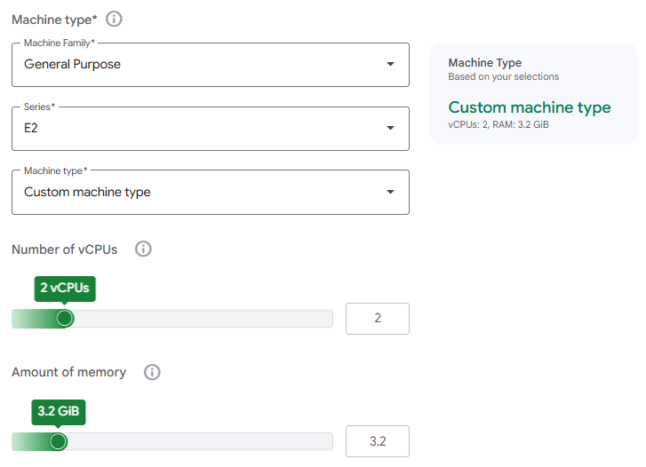
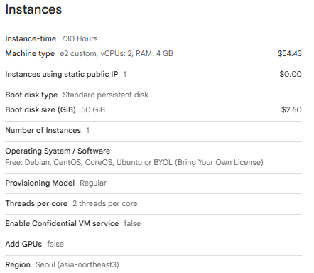
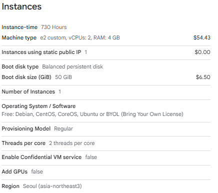
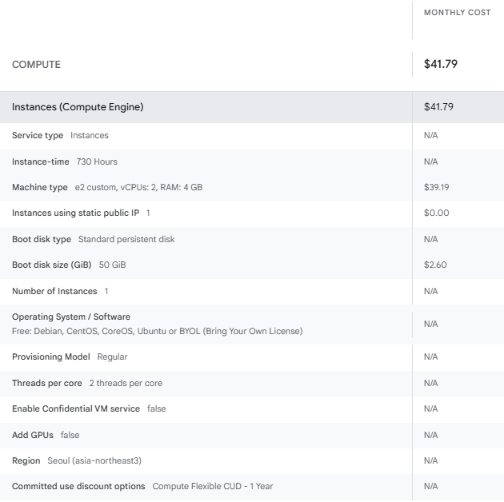
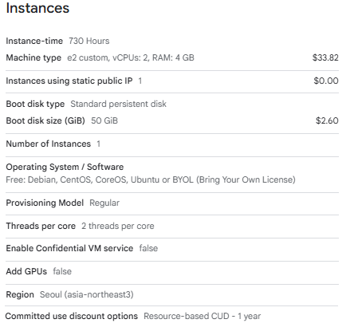

+++
title = 'GCP VM 비용 줄이기: 소규모 백엔드 서버의 사양과 요금 선택'
date = '2026-10-16T00:00:00+09:00'
draft = false
slug = 'gcp-vm-cost-optimization'
description = 'GCP 서울 리전에서 소규모 앱·웹 백엔드용 VM 비용을 줄이는 방법을 정리한다. E2 커스텀 2vCPU·4GiB와 공유 코어 VM, HDD·Balanced SSD, 공인 IPv4, Standard 네트워크를 조합해 월 비용을 계산한다.'
tags = ['gcp', 'compute-engine', 'custom-machine-type', 'vm', 'cost']
categories = ['IT개발']
showTableOfContents = true
+++

앱·웹 백엔드 서버 한 대를 GCP에서 운영하려는데, 2vCPU·메모리 8GiB는 필요 이상으로 커 보일 수 있다. 그렇다고 VM 요금만 낮추면 디스크·공인 IP·인터넷 데이터 전송 비용을 빠뜨리기 쉽다.

**소규모 백엔드의 시작 후보로 E2 커스텀 2vCPU·메모리 4GiB를 검토**하고, 디스크와 네트워크까지 더해 월 예산을 계산했다. 요청이 드물고 CPU 사용량이 낮다면 더 저렴한 `e2-medium`·`e2-small`도 후보가 된다. 특정 사양으로 처리할 수 있는 동시 접속자 수나 요청 수를 보장하는 글은 아니다.

## 1. 먼저 볼 추천 구성과 월 비용

가격 확인일은 **2026년 10월 16일**이다. 서울(`asia-northeast3`), 유료 OS 라이선스가 없는 Linux VM 1대, **월 730시간**, 온디맨드, 단일 존 디스크, 사용 중인 공인 IPv4 1개를 기준으로 계산했다. 앞의 비교표는 약정·Spot·신규 가입 크레딧을 제외하며, 약정 견적은 7절에서 별도로 비교한다. 원화는 **$1 = 1,400원 가정, VAT 제외**이며 실제 청구 환율이나 원화 SKU 가격과 다를 수 있다.


| 선택 방향 | VM 사양 | 디스크 | VM 요금 | 디스크 요금 | IPv4 | 월 기본비 | 원화 환산 |
| --- | --- | --- | ---: | ---: | ---: | ---: | ---: |
| 비용 우선, 낮은 CPU 사용량 | 0.5vCPU·메모리 2GiB e2-small, 공유 코어 | HDD 50GiB | $15.69 | $2.60 | $3.65 | **$21.94** | **30,716원** |
| 비용 우선, 메모리 4GiB 필요 | 1vCPU·메모리 4GiB e2-medium, 공유 코어 | HDD 50GiB | $31.38 | $2.60 | $3.65 | **$37.63** | **52,682원** |
| 커스텀, 저장 비용 최소화 | 2vCPU·메모리 4GiB | HDD 50GiB | $54.43 | $2.60 | $3.65 | **$60.68** | **84,952원** |
| 커스텀, 저장 공간 여유 | 2vCPU·메모리 4GiB | HDD 100GiB | $54.43 | $5.20 | $3.65 | **$63.28** | **88,592원** |
| 커스텀, 디스크 응답성 고려 | 2vCPU·메모리 4GiB | Balanced SSD 50GiB | $54.43 | $6.50 | $3.65 | **$64.58** | **90,412원** |


공유 코어 행의 vCPU는 **두 vCPU를 합산한 지속 CPU 할당량**이다. 게스트 OS에는 둘 다 2개 vCPU가 보이며, 자세한 차이는 3절에서 설명한다.

**기본비에는 인터넷 아웃바운드(이그레스) 요금, 백업·스냅샷, 관리형 DB, LB·NAT, 유료 DNS, 로그·모니터링의 별도 과금 항목을 포함하지 않았다.** VM과 디스크는 제공된 계산기 견적을 사용했다. 공유 코어 두 행의 HDD 50GiB는 해당 VM 요금에 50GiB 디스크 요금을 조합한 계산 예시이며, 원본 견적의 HDD는 100GiB다.

이 표는 GCP 전체 상품의 절대 최저가 순위가 아니다. `e2-micro` 같은 더 작은 상품도 있지만, 여기서는 제공된 견적과 메모리 2~4GiB급 후보를 비교한다. Compute Engine 무료 사용량의 `e2-micro`는 미국의 지정 리전 조건이 있으므로 **서울 VM을 무료로 운영하는 근거로 사용하지 않는다.** [무료 사용량 조건](https://docs.cloud.google.com/free/docs/free-cloud-features#compute)

## 2. 커스텀 머신으로 쓰지 않는 메모리 줄이기

`e2-standard-2`는 2vCPU·메모리 8GiB다. CPU는 2vCPU가 필요하지만 메모리는 4GiB면 충분하다면, **E2 Custom machine type에서 2vCPU·4GiB로 조절**하는 방식을 검토할 수 있다.

위 캡처는 조절 기능을 보여주기 위해 **2vCPU·3.2GiB**를 입력한 화면이다. 본문의 비용은 아래 **4GiB 견적**을 기준으로 계산했다. 실제 VM 생성 시에는 시리즈별 허용 범위와 메모리 설정 단위를 따라야 한다. E2 일반 커스텀은 2vCPU부터 2개 단위, 메모리는 256MiB 단위이므로, 계산기에 소수를 입력할 수 있다고 그 값 그대로 생성할 수 있다고 보지는 않는다. [커스텀 머신 생성 조건](https://docs.cloud.google.com/compute/docs/instances/creating-instance-with-custom-machine-type)


| 구성 | vCPU | 메모리 | 월 VM 요금 | 차이 |
| --- | ---: | ---: | ---: | --- |
| e2-standard-2 | 2 | 8GiB | $62.75 | 비교 기준 |
| E2 커스텀 | 2 | 4GiB | $54.43 | **월 $8.32, 약 13.3% 절감** |


출처는 [e2-standard-2 견적](e2-standard-2-hdd-100-estimate.png)과 [E2 커스텀 견적](e2-custom-hdd-100-estimate.png)이다. CPU를 줄인 것이 아니라 메모리를 8GiB에서 4GiB로 줄여 합계가 낮아진 예시다.

커스텀이라고 항상 저렴한 것은 아니다. 공식 문서는 커스텀 온디맨드 단가에 정형 머신 대비 5% 할증이 있다고 안내한다. 필요한 자원량을 줄인 이익과 커스텀 단가를 함께 봐야 하며, 위 계산기의 표시 금액에 할증을 다시 더하지 않는다. [커스텀 요금 안내](https://docs.cloud.google.com/compute/docs/instances/creating-instance-with-custom-machine-type#custom_machine_type_pricing)

CPU·메모리를 조절하는 방식이 **GCP에만 있는 것은 아니다.** OCI도 Flexible Shapes를 제공한다. 이 글에서는 GCP의 커스텀 머신으로 불필요한 자원 비용을 줄이는 방법에 집중한다. [OCI Flexible Shapes](https://www.oracle.com/cloud/compute/virtual-machines/)

4GiB 추천은 작은 API 서버나 웹 애플리케이션의 **초기 검토 사양**이다. 같은 VM에 DB·캐시까지 함께 실행하거나 JVM 힙·컨테이너 메모리를 크게 잡는다면 부족할 수 있다. OS와 런타임 사용량을 남겨두고 실제 부하에서 확인한다.

## 3. 더 저렴하게 쓰려면 e2-medium부터 비교하기

`e2-medium`은 메모리 4GiB에 월 VM 요금 $31.38로, 커스텀 2vCPU·4GiB보다 저렴하다. 대신 **지속 CPU 할당량이 다르다.**


| 상품 | 메모리 | 게스트 OS에 보이는 vCPU | 지속 CPU 할당량 | 월 VM 요금 |
| --- | ---: | ---: | --- | ---: |
| e2-small | 2GiB | 2개 | 두 vCPU 합산 0.5vCPU 상당 | $15.69 |
| e2-medium | 4GiB | 2개 | 두 vCPU 합산 1vCPU 상당 | $31.38 |
| E2 커스텀 2vCPU·4GiB | 4GiB | 2개 | 공유 코어 상품의 시간 분할 제한과 구분 | $54.43 |


공유 코어는 짧은 시간 CPU를 더 사용할 수 있지만 그 성능을 계속 유지하는 상품은 아니다. 계산기의 `e2-small: vCPUs 0.5`, `e2-medium: vCPUs 1` 표기는 게스트 OS에 CPU가 각각 0.5개·1개만 보인다는 뜻이 아니다. [E2 공유 코어와 CPU 버스트](https://docs.cloud.google.com/compute/docs/general-purpose-machines#e2_shared-core)

견적: [e2-small + HDD 100GiB](e2-small-hdd-100-estimate.png), [e2-medium + HDD 100GiB](e2-medium-hdd-100-estimate.png).

**요청이 드물고 CPU 사용량이 낮으면 e2-medium을 먼저 검토**한다. 요청 처리·배치·압축·이미지 변환 등으로 CPU를 지속적으로 사용한다면, 공유 코어와 일반 커스텀에서 응답 지연과 처리량을 비교한 뒤 선택한다.

## 4. 디스크는 HDD와 Balanced SSD를 구분하기

서울 견적의 디스크 용량별 월 요금은 다음과 같다. 사용한 데이터 양이 아니라 **할당한 용량**을 기준으로 요금이 발생한다. [디스크 요금](https://cloud.google.com/compute/disks-image-pricing)


| 종류 | GCP 이름 | 50GiB | 100GiB | 먼저 검토할 상황 |
| --- | --- | ---: | ---: | --- |
| HDD | Standard Persistent Disk, pd-standard | $2.60 | $5.20 | 저장 비용 우선, 랜덤 I/O 요구가 낮음 |
| SSD 기반 | Balanced Persistent Disk, pd-balanced | $6.50 | $13.00 | OS·패키지·컨테이너·DB 등의 디스크 응답성 고려 |


**Balanced Persistent Disk는 SSD 기반이지만, 별도 상품인 SSD Persistent Disk(`pd-ssd`)와는 다르다.** 이번 캡처의 SSD 후보는 Balanced다. `pd-ssd`가 필요하다면 별도 견적을 조회한다. [Persistent Disk 종류](https://docs.cloud.google.com/compute/docs/disks/persistent-disks)

용량이 많이 필요 없고 랜덤 I/O 요구가 낮으면 HDD 50GiB, 파일·이미지 저장 공간이 더 필요하면 HDD 100GiB를 검토한다. 단, **작은 HDD는 용량이 남아도 I/O 성능이 부족할 수 있다.** 디스크 성능에는 종류뿐 아니라 용량·VM 사양도 영향을 준다. DB를 같은 VM에 두거나 디스크 대기가 관찰되면 Balanced 50GiB부터 비교한다. Google도 일반적인 부팅 디스크의 일관된 성능에는 Balanced를 권고한다. [부팅 디스크 안내](https://docs.cloud.google.com/compute/docs/disks/persistent-disks#performance), [성능 제한](https://docs.cloud.google.com/compute/docs/disks/performance)

같은 커스텀 VM에서 HDD 50GiB를 Balanced 50GiB로 바꾸면 **월 $3.90, 가정 환율로 5,460원**이 추가된다. 비용 차이가 작다면 부팅·배포·DB 접근의 응답성을 함께 보고 결정한다. 용량을 100GiB로 늘리는 경우의 견적은 [HDD 100GiB](e2-custom-hdd-100-estimate.png), [Balanced 100GiB](e2-custom-balanced-100-estimate.png)에서 확인할 수 있다.

## 5. 공인 IPv4 비용 포함하기

일반 VM에서 사용하는 **고정·임시 외부 IPv4는 시간당 $0.005**다. VM 견적과 별도로 `0.005 × 730 = $3.65`를 월 예산에 포함한다. 무료 1시간의 세부 차감은 별도로 적용하지 않은 값이다. [공인 IPv4 요금](https://cloud.google.com/vpc/network-pricing#ipaddress)

외부 IP를 제거하는 구조는 접속 경로와 NAT·LB 등의 추가 비용까지 함께 계산해야 하므로 이 글의 직접 접속 VM과 구분한다.

## 6. Standard 네트워크로 월 데이터 전송 비용 비교하기

서울 VM에서 한국 이용자에게 인터넷으로 직접 전송하는 경우의 요금이다.


| 네트워크 등급 | 이 예시에 적용할 무료량 | 적용 구간 단가 |
| --- | --- | --- |
| Premium, 서울 → 한국 | 해당 구간 무료량 없음 | $0.19/GiB |
| Standard, 서울 출발 | 계정 전체·모든 리전 합산 월 200GiB | 200GiB 초과~10,240GiB 구간 $0.119/GiB |


가격표 캡처: [Premium 서울 → 한국](/posts/gcp-cloud-vpn-selection-guide/gcp-seoul-korea-egress-pricing.png), [Standard 서울 출발](/posts/cloud-vm-cost-comparison/gcp-standard-egress-pricing.png). Standard의 무료 200GiB는 현재 [공식 네트워크 요금 안내](https://cloud.google.com/vpc/network-pricing#standard_tier_pricing)를 따른다. 다른 자원에서 무료량을 사용하지 않았다고 가정하며, VM마다 200GiB를 중복 차감하지 않는다.

아래는 **E2 커스텀 2vCPU·4GiB + Balanced 50GiB + IPv4**, 월 기본비 **$64.58**에 인터넷 아웃바운드(이그레스)를 더한 결과다. 데이터 용량은 GCP 요금표의 과금 단위인 **GiB**로 표시했다.


| 월 아웃바운드(이그레스) | Standard 전송 요금 | Standard 월 총액 | Premium 전송 요금 | Premium 월 총액 |
| --- | ---: | ---: | ---: | ---: |
| 1GiB | $0.00 | **$64.58 / 90,412원** | $0.19 | **$64.77 / 90,678원** |
| 10GiB | $0.00 | **$64.58 / 90,412원** | $1.90 | **$66.48 / 93,072원** |
| 100GiB | $0.00 | **$64.58 / 90,412원** | $19.00 | **$83.58 / 117,012원** |


Standard의 계산식은 `max(월 GiB − 200, 0) × $0.119`, Premium은 위 예시 구간에서 `월 GiB × $0.19`다. 더 큰 사용량에는 다른 구간 단가가 적용될 수 있다.

Standard는 인터넷 통신 사업자의 경로를 더 활용하는 비용 최적화 등급이고, Premium은 Google 백본을 더 활용한다. **등급을 바꾸면 품질이 같다는 가정은 하지 않는다.** 이용자 위치에서 응답 지연을 확인하고, VM에 연결하는 외부 IP도 Standard 등급으로 구성한다. 기존 IP는 등급 간에 그대로 이동할 수 없으므로 변경 시 IP와 DNS 영향도 확인한다. [Network Service Tiers](https://docs.cloud.google.com/network-tiers/docs/overview)

## 7. 장기 운영이 확실하면 1년·3년 약정 검토

계속 사용할 자원이 확인되면 **약정 사용 할인**(CUD, Committed Use Discounts)으로 VM 비용을 더 줄일 수 있다. Compute Engine에서는 리소스 기반과 Compute Flexible 두 방식을 구분한다.


| 방식 | 무엇을 약정하나 | 먼저 검토할 상황 |
| --- | --- | --- |
| 리소스 기반 CUD | 특정 리전·머신 계열의 vCPU·메모리 등 자원량 | 같은 리전·계열의 자원을 꾸준히 사용 |
| Compute Flexible CUD | 대상 서비스·자원의 시간당 최소 지출 금액 | 리전·머신 계열을 바꿀 수 있지만 대상 지출은 꾸준함 |


둘 다 특정 VM 한 대를 고정하는 계약은 아니다. Flexible은 같은 결제 계정의 대상 사용량에 리전·머신 계열을 넘어서 적용할 수 있지만, 모든 서비스와 요금 항목에 적용되는 것은 아니다. E2의 대상 vCPU·메모리에는 Flexible 기준 **1년 28%·3년 46% 할인**이 안내되어 있으며, 이를 리소스 기반 CUD의 공통 할인율로 사용하지 않는다. [공식 CUD 비교](https://docs.cloud.google.com/compute/docs/instances/committed-use-discounts-overview)

**E2 커스텀 2vCPU·메모리 4GiB + HDD 50GiB + 공인 IPv4**, 서울 리전·월 730시간으로 통일했다. 디스크는 앞의 네트워크 총비용 예시에 사용한 Balanced가 아니라 HDD다.


| 요금 방식 | 월 VM 요금 | HDD 50GiB | 공인 IPv4 | 월 기본비 | 원화 환산 |
| --- | ---: | ---: | ---: | ---: | ---: |
| 온디맨드 | $54.43 | $2.60 | $3.65 | **$60.68** | **84,952원** |
| Flexible CUD 1년 | $39.19 | $2.60 | $3.65 | **$45.44** | **63,616원** |
| Flexible CUD 3년 | $29.39 | $2.60 | $3.65 | **$35.64** | **49,896원** |
| 리소스 기반 CUD 1년 | $33.82 | $2.60 | $3.65 | **$40.07** | **56,098원** |
| 리소스 기반 CUD 3년 | $24.49 | $2.60 | $3.65 | **$30.74** | **43,036원** |


VM 요금은 각 방식의 계산기 표시값을 사용하고, HDD $2.60과 공인 IPv4 $3.65를 더했다. **HDD·IPv4·인터넷 아웃바운드(이그레스) 비용에 VM 할인율을 일괄 적용하지 않는다.** 이 견적에서는 리소스 기반이 같은 기간의 Flexible보다 저렴하지만, 사용할 리전·계열과 변경 가능성을 함께 보고 선택한다.

**Compute Flexible CUD 견적**

[Compute Flexible CUD 3년 약정 견적 보기](e2-custom-flexible-cud-3-year.png)

**리소스 기반 CUD 견적**

[리소스 기반 CUD 3년 약정 견적 보기](e2-custom-resource-cud-3-year.png)

표의 약정 금액은 **이 VM 사용량을 충당하는 규모로 자원량 또는 지출 금액을 약정하고 매시간 활용한다는 가정의 월 환산 예산**이다. 필요 이상으로 약정하거나 활용하지 못하면 이 예산과 달라진다. 두 방식 모두 VM을 중지·삭제해도 약정은 남으며, 사용하지 않은 시간에도 약정 비용을 낸다. 구매 후 취소할 수 없으므로 처음부터 할인율만 보고 3년 약정을 선택하지 않는다. [약정 적용 방식과 구매 조건](https://docs.cloud.google.com/compute/docs/instances/committed-use-discounts-overview)

**처음에는 온디맨드로 운영하고, 필요한 사양과 지속 사용량을 확인한 뒤 계속 사용할 자원량이나 금액만 약정**한다. 위 월 기본비에는 인터넷 데이터 전송과 백업 등 별도 비용이 포함되지 않는다.

## 8. 실제 견적에 적용할 순서

1. 서울 리전, Linux, 730시간, Regular·온디맨드 조건으로 계산한다.
2. 낮은 CPU 사용량이면 e2-medium, 지속 CPU 자원이 필요하면 E2 커스텀 2vCPU·4GiB를 후보로 정한다.
3. HDD 50GiB·100GiB와 Balanced 50GiB를 비교한다. 로컬 DB와 랜덤 I/O 요구를 함께 본다.
4. 공인 IPv4를 별도 항목으로 더하고, 인터넷 아웃바운드(이그레스)는 Standard·Premium을 나눠 계산한다.
5. 백업·관리형 DB·로그·DNS 등 실제 사용할 별도 서비스를 더한 뒤 예산 알림을 설정한다.
6. 온디맨드로 운영하며 필요한 사양과 지속 사용량을 확인한 뒤, 계속 사용할 자원량이나 금액만 약정한다.

알림 전용 예산은 초과 지출을 자동으로 차단하는 설정이 아니다. 예상하지 못한 트래픽이나 로그 비용을 발견할 수 있도록 대상 프로젝트와 알림 기준을 확인한다. [예산과 알림 설정](https://docs.cloud.google.com/billing/docs/how-to/budgets)

**요청이 드문 서버는 e2-medium, 공유 코어의 지속 CPU 할당량이 부족하면 커스텀 2vCPU·4GiB**부터 검토한다. HDD와 Balanced 50GiB의 기본비 차이는 월 $3.90이다. 메모리를 줄이는 효과만 보지 말고, 실제 부하에서 메모리 부족·CPU 사용량·디스크 대기·응답 시간을 확인해 사양을 결정한다.
