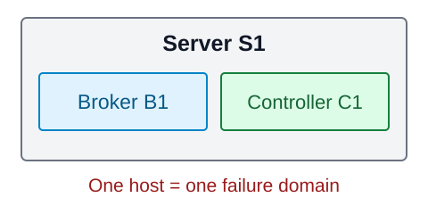
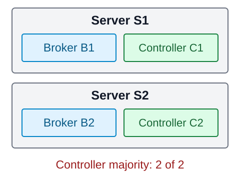
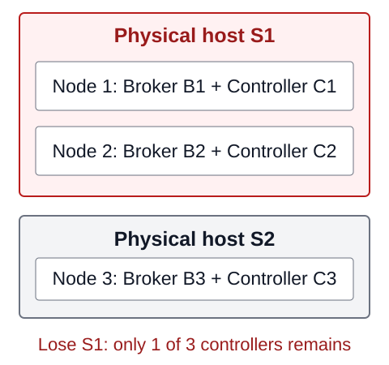
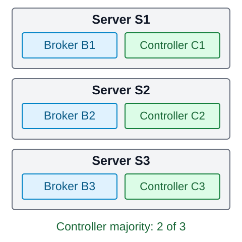
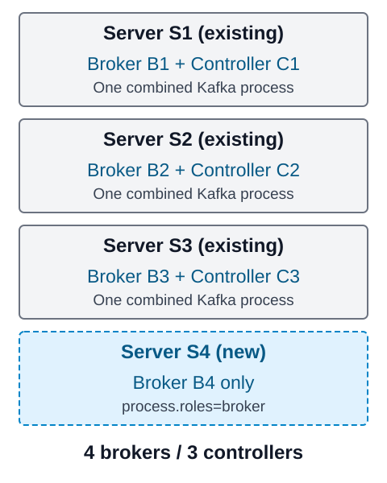

+++
title = 'Kafka 서버는 몇 대가 필요할까? 1대·2대·3대 구성과 Scale-out'
date = '2026-10-09T00:00:00+09:00'
draft = false
slug = 'kafka-cluster-architecture-guide'
description = '물리 서버와 VM에 Kafka를 배치할 때 1대·2대·3대 구성이 어떻게 달라지는지 비교한다. Broker와 Controller, KRaft 쿼럼과 메시지 복제, 역할 분리와 Broker Scale-out의 파티션 재배치를 설명한다.'
tags = ['kafka', 'kraft', 'architecture', 'high-availability', 'scale-out']
categories = ['IT개발']
showTableOfContents = true
+++

Kafka 클러스터를 설계할 때는 **노드별 역할 배치, Controller 쿼럼, 토픽 복제 설정**을 함께 결정해야 한다. 서버 한 대 장애 시 서비스 지속 여부와 데이터 복제본 수는 이 구성에 따라 달라지며, 서버를 증설하는 것만으로 장애 대응이나 복제본 수 증가가 보장되지는 않는다.

이 글은 **Apache Kafka 4.3의 KRaft 구성**을 기준으로 서버 대수별 배치와 장애 대응 조건을 비교한다. 구성도는 설명용이며, 실제 물리 서버 설치나 장애 테스트를 수행한 결과는 아니다. 설치 명령 전체를 나열하기보다 어떤 구성을 선택할지에 집중한다.

## 1. 물리 서버와 VM, 무엇을 기준으로 셀까?

여기서 서버는 물리 서버 또는 VM이다. **1·2·3대 비교에서는 서버 한 대에 Broker와 Controller를 겸용하는 Kafka 노드 하나**를 배치한다. 기본안은 독립된 서버 3대의 겸용 구성이고, 확장할 때는 기존 Controller를 유지하며 Broker 전용 서버를 추가한다. 역할 분리는 별도 운영 선택지로 설명한다.

노드 수와 장애가 함께 발생하는 범위는 다르다.

| 배치 | 한 곳의 장애가 미치는 영향 |
| --- | --- |
| 물리 서버 한 대에 Kafka 컨테이너 3개 | 호스트가 중단되면 노드 3개가 함께 중단 |
| 같은 물리 호스트 위의 VM 3대 | 호스트 장애로 VM 3대가 함께 중단될 수 있음 |
| 서로 다른 물리 서버 또는 호스트에 분산된 VM | 한 호스트 장애가 모든 노드를 동시에 중단시키지 않도록 배치 가능 |

이처럼 함께 중단될 수 있는 범위를 **장애 도메인**(failure domain)이라고 한다. 물리 서버를 나눠도 같은 전원·랙·네트워크를 공유하면 공통 장애가 남는다. 클라우드에서도 VM 개수만 세지 말고, 가용 영역과 호스트 분산 등 실제 배치 조건을 확인해야 한다.

한 PC에서 컨테이너 3개로 Kafka 노드 동작을 학습할 수는 있지만, 물리 서버 3대의 장애 격리를 검증했다고 볼 수는 없다.

## 2. Broker와 Controller는 역할이 다르다

| 역할 | 담당하는 일 | 늘리는 목적 |
| --- | --- | --- |
| Broker | 파티션 데이터를 저장하고 메시지 발행·조회 요청 처리 | 저장 용량과 데이터 처리 부하 분산 |
| Controller | 클러스터 메타데이터 관리, Broker 상태에 따른 파티션 리더 선출 등 | 클러스터 관리 기능의 장애 대응 |

KRaft에서는 Kafka 노드의 `process.roles`로 역할을 지정한다.

```properties
# 역할별 설정 예시이며, 완성된 설치 설정 파일은 아니다.
process.roles=broker
# 또는 controller
# 또는 broker,controller
```

Broker가 고객 메시지를 저장하는 역할이라면, Controller는 어느 Broker가 어떤 파티션을 담당하는지 같은 관리 정보를 다룬다. **Producer와 Consumer의 일반 메시지 발행·조회는 Broker로 연결하며, Controller를 경유하는 구조가 아니다.** [Kafka 역할 설정](https://kafka.apache.org/43/operations/kraft/), [Kafka Producer와 Consumer 동작](https://kafka.apache.org/43/design/design/)

### Controller 쿼럼: 3개 중 2개가 필요한 이유

Controller 집합은 **메타데이터 쿼럼**(metadata quorum)을 구성한다. 관리 정보의 변경을 합의해 확정하려면, 투표에 참여하는 Controller의 과반수가 정상적으로 통신할 수 있어야 한다.

| 투표 Controller 수 | 필요한 과반수 | 견딜 수 있는 Controller 중단 |
| --- | ---: | ---: |
| 1개 | 1개 | 0개 |
| 2개 | 2개 | 0개 |
| 3개 | 2개 | 1개 |
| 5개 | 3개 | 2개 |

과반수는 절반 이상이 아니라 **절반을 초과하는 수**다. 두 Controller 중 하나만 남으면 과반수가 아니다. 세 개 중 두 개가 남으면 과반수다. 단순히 프로세스가 실행 중인 것만으로 충분하지 않고, 필요한 Controller들이 서로 통신할 수 있어야 한다. [Kafka Controller 쿼럼](https://kafka.apache.org/43/operations/kraft/)

## 3. 서버 1대: 개발·실습용 구성



한 노드에 `process.roles=broker,controller`를 지정하는 겸용 구성이다. Broker 1개, Controller 1개이며, 토픽 복제본도 이 구성에서는 최대 1개다.

- 서버를 중지하면 메시지 처리와 클러스터 관리가 함께 중단된다.
- 재시작할 때 기존 디스크가 정상이라면 데이터를 이어 사용할 수 있다.
- 저장 디스크를 잃으면 다른 Broker에서 복구할 복제본이 없다. 영속 볼륨은 복제나 백업을 대신하지 않는다.

개발 환경, 기능 확인, 재생성 가능한 테스트 데이터에 적합하다. 앞서 작성한 [Kafka UI 설치 실습](/posts/kafka-ui-guide/)도 이런 단일 노드 구성이다.

## 4. 서버 2대: 복제할 수 있어도 고가용성은 별개



두 서버에 겸용 노드를 하나씩 실행하면 Broker 2개, Controller 2개다. **토픽의 복제본을 2개로 구성할 수는 있지만, Controller 하나가 중단되면 과반수가 사라진다.**

또한 데이터 복제 쪽에도 선택이 필요하다. 복제본 수(replication factor, RF)가 2인 토픽에서 Producer가 `acks=all`로 발행한다고 가정한다.

| 토픽 설정 | Broker 하나가 중단돼 동기화된 복제본이 하나만 남으면 |
| --- | --- |
| `min.insync.replicas=2` | 최소 복제 조건을 충족하지 못해 새 메시지 발행 성공을 유지할 수 없음 |
| `min.insync.replicas=1` | 데이터 복제 조건은 충족할 수 있지만 새 메시지는 한 복제본에만 의존할 수 있음 |

이 표는 **데이터 복제 조건만** 비교한 것이다. 같은 서버에 둔 Controller도 함께 중단되므로, 두 번째 설정을 선택해도 전체 클러스터의 고가용성이 확보됐다는 뜻은 아니다.

Controller 과반수가 사라진 순간 모든 기존 조회가 반드시 즉시 중단된다고 단정할 수는 없다. 다만 리더 재선출과 메타데이터 변경에 필요한 합의를 유지할 수 없으므로, 장애 후 정상 운영을 보장하는 구성으로 볼 수 없다.

### 물리 서버 2대에 Kafka 노드 3개를 넣으면?



겸용 노드 3개를 물리 서버 두 대에 `2+1`로 배치한다고 가정한다. Broker와 Controller는 각각 3개지만, 함께 중단되는 범위는 두 곳뿐이다.

| 중단된 물리 서버 | 남은 Controller | 관리 쿼럼 |
| --- | ---: | --- |
| 노드 2개가 있는 S1 | 1개 | 유지 불가 |
| 노드 1개가 있는 S2 | 2개 | 남은 두 개가 통신하면 유지 가능 |

RF 3으로 구성해도 복제본 두 개가 같은 물리 서버에 놓인다. S1이 중단되면 Controller 두 개와 데이터 복제본 두 개를 동시에 잃어, 앞서 설명한 `min.insync.replicas=2` 조건도 충족하지 못한다.

이것은 **특정 서버의 장애는 견디지만 어느 서버의 장애든 견디는 구성은 아니다.** 기존 시스템에서 두 서버를 Active/Active로 운영했다고 해서 Kafka에도 같은 장애 대응 조건이 적용되지는 않는다. Kafka는 클러스터 전체를 Active/Standby 한 쌍으로 전환하는 대신, Controller 쿼럼과 파티션별 리더·복제본을 관리한다.

## 5. 서버 3대: 관리 쿼럼과 데이터 복제를 함께 구성



세 서버에 겸용 노드를 하나씩 두면 Broker 3개, Controller 3개다. 한 서버가 중단돼도 나머지 Controller 두 개가 통신할 수 있다면 관리 쿼럼을 유지할 수 있다.

그러나 **Broker 3개가 있다고 모든 토픽이 자동으로 3개씩 복제되는 것은 아니다.** 토픽별 복제본 수를 확인해야 한다. RF 3은 원본 외에 3개를 추가한다는 뜻이 아니라 **파티션별 전체 복제본이 3개**라는 뜻이다. 토픽 생성 명령에서는 `--replication-factor 3` 옵션으로 지정한다. 이는 `--config replication.factor=3`으로 설정하는 항목이 아니다.

### 메시지 쓰기를 위한 설정 예시

| 위치 | 설정 | 의미 |
| --- | --- | --- |
| 토픽 생성 옵션 | `--replication-factor 3` | 파티션을 서로 다른 Broker 3개에 저장 |
| 토픽 | `min.insync.replicas=2` | 쓰기 성공에 필요한 동기화된 복제본의 최소 수 |
| Producer | `acks=all` | 현재 ISR의 복제 확인을 기다려 발행 결과 판단 |

**ISR**(In-Sync Replicas)은 리더와 동기화된 복제본 집합이다. `acks=all`이 항상 복제본 3개를 기다린다는 뜻은 아니다. 위 구성에서 ISR이 3개라면 3개의 확인을 기다리고, 한 Broker 중단 후 ISR이 2개라면 최소 조건을 충족한 2개로 쓰기를 지속할 수 있다. [Kafka 최소 ISR 설정](https://kafka.apache.org/43/configuration/topic-configs/), [Producer acks 설정](https://kafka.apache.org/43/configuration/producer-configs/)

이는 **모든 복제본이 정상적으로 동기화돼 있었고, 한 서버 장애 후 남은 두 서버와 클라이언트 간 통신이 정상인 상황**의 예시다. 전환 중 재시도나 일시적 오류가 없다는 보장은 아니다. Controller가 정상이어도 해당 파티션의 정상 복제본이 부족하면 쓰기는 실패할 수 있다.

Kafka 4.x의 ELR(Eligible Leader Replicas)은 장애 시 리더 후보를 관리하는 추가 기능이다. 여기서는 ISR이 충분한 정상 상태에서 한 서버가 중단되는 경우를 설명하며, ISR이 부족한 복구 상황의 리더 선출 조건까지 단순화하지 않는다. [Kafka ELR 설명](https://kafka.apache.org/43/operations/eligible-leader-replicas/)

### 예산과 운영 단순화를 고려한 기본안: 독립된 서버 3대

이 글에서 제안하는 기본안은 **서버 3대에 Kafka 겸용 노드를 하나씩 배치하는 구성**이다. Kafka 프로세스는 총 3개이며, 각 프로세스가 Broker와 Controller 역할을 함께 수행한다. 서버마다 두 역할을 별도 프로세스로 실행하는 6프로세스 구성이 아니다.

| 서버 | Kafka 설정 | 역할 |
| --- | --- | --- |
| S1 | `node.id=1`, `process.roles=broker,controller` | Broker B1 + Controller C1 |
| S2 | `node.id=2`, `process.roles=broker,controller` | Broker B2 + Controller C2 |
| S3 | `node.id=3`, `process.roles=broker,controller` | Broker B3 + Controller C3 |

물리 서버라면 서로 다른 머신 3대, VM이라면 서로 다른 물리 호스트에 분산한다. VM 이동 후 같은 호스트에 모이지 않도록 배치 정책도 유지한다. 일반 토픽과 필요한 내부 토픽의 복제 설정, Producer의 `acks`, 장애 후 남은 두 서버의 처리 여력을 함께 확인한다.

**이것은 예산과 운영 단순화를 고려한 기본 구성안이지, 중요한 운영 환경에 대한 Kafka의 공식 권장 배치라는 뜻은 아니다.** 겸용 모드는 Broker 부하가 Controller에 영향을 주며, 같은 노드의 두 역할을 독립적으로 재시작하기 어렵다. Kafka 공식 문서는 중요한 운영 환경에서는 겸용을 피하고 역할을 분리하도록 안내한다. 도입할 때 이 제한을 명시하고 부하·장애 전환·유지보수 조건을 검증해야 한다. [Kafka 겸용 모드 운영 주의사항](https://kafka.apache.org/43/operations/kraft/)

## 6. Scale-out: 네 번째 서버에는 Broker만 추가

저장 용량이나 메시지 처리 부하 때문에 확장한다면, **기존 서버 3대는 그대로 두고 새 서버 S4에 Broker 역할만 실행하는 Kafka 노드**를 추가할 수 있다.



| 서버 | 확장 후 역할 | `process.roles` |
| --- | --- | --- |
| S1 | Broker B1 + Controller C1 | `broker,controller` |
| S2 | Broker B2 + Controller C2 | `broker,controller` |
| S3 | Broker B3 + Controller C3 | `broker,controller` |
| S4 | Broker B4 | `broker` |

새 서버에도 같은 Kafka를 설치하되, 고유한 `node.id=4`와 `process.roles=broker`로 기존 클러스터에 연결한다. **확장 후 Broker는 4개, Controller는 기존 3개**다. Controller 쿼럼의 투표 멤버를 추가하는 작업은 아니다.

S4에 Controller가 없다는 뜻은 Controller와 통신하지 않는다는 뜻이 아니다. 새 Broker도 기존 Controller 쿼럼의 주소를 알아야 하고, 기존 클러스터와 같은 Cluster ID, 접속 가능한 리스너와 영속 저장소를 준비해야 한다.

이 방식으로 Broker가 5개, 6개로 늘어도 Controller 수를 같이 늘릴 필요는 없다. Controller는 관리 기능의 가용성과 메타데이터 부하를 기준으로 별도 계획한다. Broker를 추가해도 기존 S1~S3의 겸용 모드가 역할 분리 모드로 바뀌는 것은 아니다.

### Broker를 추가해도 기존 파티션은 자동 이동하지 않는다

기존 파티션이 B1·B2·B3에 배치된 상태에서 B4를 추가해도, 기존 데이터가 알아서 B4로 분산되지는 않는다. 확장 절차는 다음처럼 나뉜다.

1. 고유한 `node.id`를 가진 Broker를 기존 클러스터에 추가한다.
2. 새 Broker가 정상 등록됐는지 확인한다.
3. 이동할 파티션 복제본과 리더 부하를 고려해 재배치 계획을 만든다.
4. `kafka-reassign-partitions.sh` 등의 관리 도구로 복제본 이동을 수행한다.
5. 이동 완료와 ISR 정상 상태, Broker별 디스크·트래픽·리더 분포를 확인한다.

기존 데이터 이동은 디스크와 네트워크 부하를 추가로 발생시킨다. 이동 속도 제한과 여유 용량을 확보해야 한다. Broker를 추가해도 토픽의 복제본 수가 자동으로 3에서 4로 바뀌지는 않는다. [Kafka Broker 확장과 파티션 재배치](https://kafka.apache.org/43/operations/basic-kafka-operations/)

### Broker 추가와 파티션 증설도 다른 작업이다

| 작업 | 바꾸는 것 |
| --- | --- |
| Broker 추가 | 데이터를 배치할 서버 수 |
| 복제본 재배치 | 기존 파티션 데이터를 저장할 Broker 목록 |
| 파티션 증설 | 토픽의 파티션 수와 소비자 병렬 처리 가능 범위 |
| 복제본 수 변경 | 파티션별 저장 사본 수 |

파티션 2개짜리 토픽은 Broker를 5개로 늘려도, 그 토픽만 구독하는 일반 consumer group에서 파티션을 맡는 소비자는 최대 2명이다. [Consumer group 실습](/posts/kafka-consumer-group-guide/)과 연결되는 부분이다.

파티션을 늘리면 key가 매핑되는 파티션이 바뀔 수 있으며 기존 메시지는 자동 재분배되지 않는다. 따라서 처리량을 늘리려면 Broker 수뿐 아니라 파티션 수, key별 부하, 소비자 처리 성능도 함께 봐야 한다. [Kafka 파티션 증설 주의사항](https://kafka.apache.org/43/operations/basic-kafka-operations/)

### 역할 분리는 별도 선택지다

**겸용은 Kafka 프로그램 하나가 Broker와 Controller 역할을 모두 수행하는 구성**이다. **역할 분리는 Kafka 프로그램을 각각 실행해 한쪽은 Broker만, 다른 쪽은 Controller만 수행하게 하는 구성**이다.


| 실행 방식 | Kafka 프로그램 수 | 각 프로그램의 설정 |
| --- | ---: | --- |
| 겸용 | 1개 | `process.roles=broker,controller` |
| 역할 분리 | 2개 | 하나는 `process.roles=broker`, 다른 하나는 `process.roles=controller` |


역할을 분리하면 프로그램마다 고유한 `node.id`, 설정 파일, 수신 포트와 저장 경로를 둔다. 같은 물리 서버에서 두 프로그램을 실행할 수도 있지만, CPU·메모리와 호스트 장애는 여전히 공유한다. **프로그램을 분리하는 것과 물리 서버를 분리하는 것은 다른 단계**다.

Kafka 공식 지침은 중요한 운영 환경에서 프로그램 하나가 두 역할을 겸하지 않도록 하라는 것이다. 물리 서버 6대를 필수로 정하지는 않는다. 역할별 서버까지 나누는 **Controller 전용 3대 + Broker 전용 3대**는 자원·서버 장애 영향을 더 강하게 격리하는 배치 예시다. [Kafka 공식 배치 지침](https://kafka.apache.org/43/operations/kraft/#deploying-considerations)

이는 3대 겸용에서 Broker를 하나 추가하는 Scale-out과 다른 설계 변경이다. 서버를 6대로 늘리거나 기존 겸용 노드에서 Controller를 제거해야만 데이터 처리 용량을 확장할 수 있는 것은 아니다. 역할을 옮기는 작업은 쿼럼 방식과 멤버 변경 절차에 맞춰 별도로 계획한다.

## 7. 설치 전에 정해야 할 설정

아키텍처를 정한 다음 실제 설치에서는 다음 항목을 맞춘다. 아래 표는 설정 점검 항목이며, 그대로 복사해 실행할 완성된 설정은 아니다.


| 항목 | 확인할 내용 |
| --- | --- |
| `process.roles` | Broker·Controller 겸용인지 전용인지 |
| `node.id` | 같은 클러스터의 노드별 고유 ID |
| Cluster ID | 새 클러스터의 각 노드가 같은 ID로 저장소 초기화 |
| `listeners` / `advertised.listeners` | 실제로 수신할 주소와 클라이언트가 접속할 수 있는 Broker 주소 |
| Controller 연결 설정 | 쿼럼 방식에 맞는 Controller 주소와 멤버 구성 |
| 데이터·메타데이터 저장 경로 | 영속 디스크, 용량, 백업과 복구 절차 |
| 토픽·내부 토픽의 복제 설정 | 일반 토픽뿐 아니라 offset·transaction 관련 내부 토픽도 점검 |
| 네트워크·인증 | Broker 간, Controller 간, 클라이언트 연결의 방화벽과 TLS·SASL 등 |


멀티 서버 구성에서 Broker가 클라이언트에 `localhost`를 광고하면 클라이언트는 자기 자신의 서버로 접속하려 한다. **bootstrap 주소만 맞추는 것이 아니라, 이후 반환되는 Broker 주소도 도달 가능해야 한다.** [Kafka Broker 연결 설정](https://kafka.apache.org/43/configuration/broker-configs/)

KRaft 쿼럼은 정적·동적 구성 방식이 있다. 정적 방식의 `controller.quorum.voters`와 동적 방식의 `controller.quorum.bootstrap.servers`를 혼용하지 않고, 클러스터의 KRaft 기능 버전과 저장소 초기화 방식에 맞춰 설정한다. 기존 실습 파일을 멀티 서버용으로 바꾸는 것만으로 쿼럼 방식이 자동 전환되는 것은 아니다. [KRaft 정적·동적 쿼럼](https://kafka.apache.org/43/operations/kraft/)

## 8. 요구사항별 구성 선택


| 요구사항 | 배치 예시 | 판단할 점 |
| --- | --- | --- |
| 개발·기능 확인 | 1대 겸용 | 서버·디스크 장애를 다른 노드가 대신하지 못함 |
| 2대만 사용할 수 있음 | 2대 겸용 또는 3노드의 2+1 배치 | 임의의 물리 서버 1대 장애를 견디는 운영 HA 구성으로 볼 수 없음 |
| 예산·운영 단순화를 고려한 3대 기본안 | 서로 다른 호스트에 겸용 Kafka 노드 하나씩 | 쿼럼·복제·자원 여력 확인, 중요한 운영 환경의 공식 역할 분리 지침과 구분 |
| 역할별 자원·서버 장애까지 격리 | Controller 전용 3대 + Broker 전용 3대 등의 배치 | 요구되는 격리 수준에 맞춰 추가 서버 확보 |
| 3대 기본안에서 저장·처리 부하 증가 | 네 번째 서버에 Broker만 추가 | Broker 4개·Controller 3개, 기존 파티션 재배치와 소비자 병렬성 점검 |


## 마무리

Kafka 서버 수를 정할 때는 **Controller 쿼럼이 남는지, 파티션의 정상 복제본이 남는지, 그 노드들이 함께 고장 나지 않는지**를 각각 확인해야 한다.

이 글의 기본안은 독립된 서버 3대에 겸용 노드를 하나씩 두는 배치다. 용량이나 처리 부하 때문에 확장할 때는 네 번째 서버에 Broker만 추가하고 기존 파티션을 재배치한다. 중요한 운영 환경에서는 겸용의 제약과 공식 역할 분리 지침을 별도로 검토해야 하며, 물리 서버 2대에 노드 3개를 넣는 것을 독립 서버 3대와 같은 장애 대응 구성으로 보면 안 된다.
