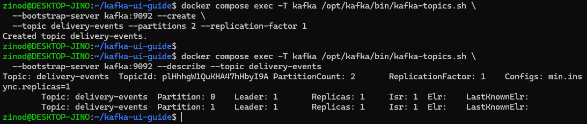
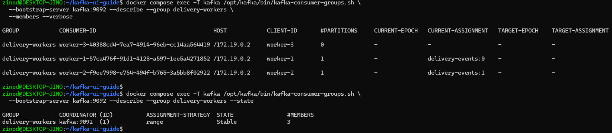
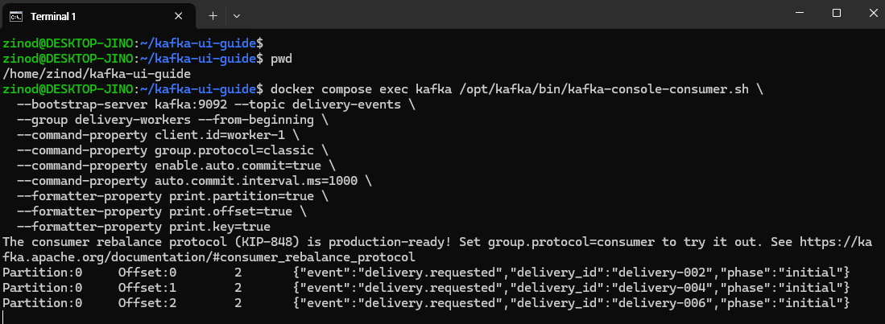
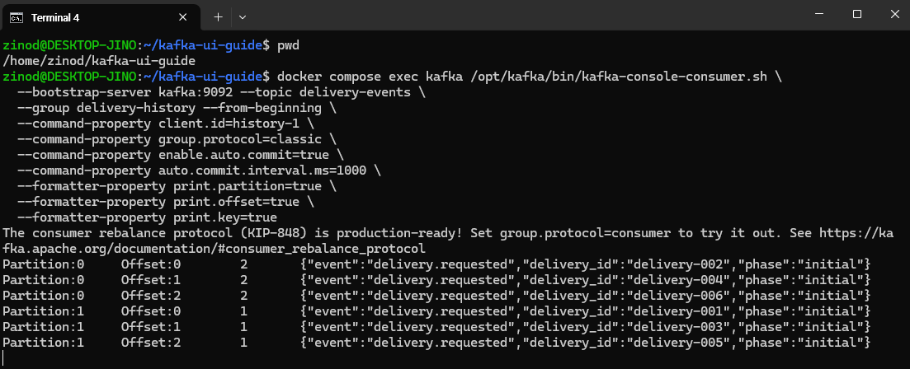
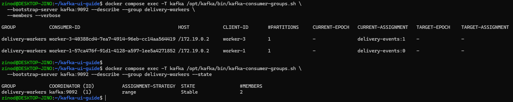
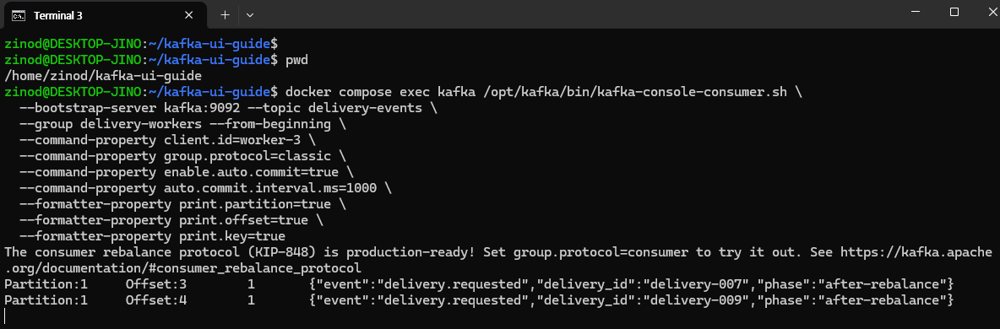
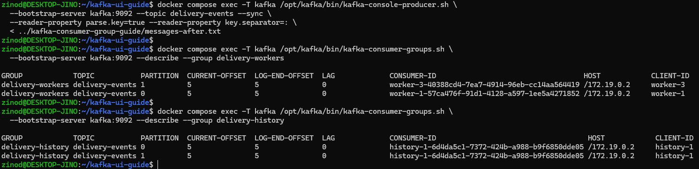
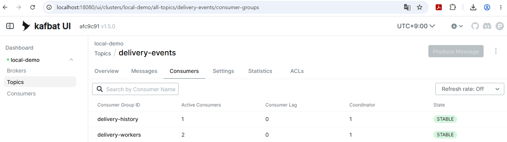

+++
title = 'Kafka consumer group 이해하기: 같은 그룹과 다른 그룹은 어떻게 동작할까?'
date = '2026-10-08T00:00:00+09:00'
draft = false
slug = 'kafka-consumer-group-guide'
description = '파티션 2개에 소비자 3개를 실행해 Kafka consumer group의 작업 분배를 확인한다. 다른 그룹의 독립 수신과 소비자 종료 후 rebalance, 커밋된 offset에서 이어 읽는 과정을 실제 캡처로 설명한다.'
tags = ['kafka', 'consumer-group', 'partition', 'rebalance', 'docker']
categories = ['IT개발']
showTableOfContents = true
+++

Kafka 소비자를 3개 실행하고 메시지 6개를 발행했는데, **두 소비자만 각각 3개를 받고 나머지 하나는 아무것도 받지 않았다.** 오류가 아니라, 파티션 2개를 같은 그룹의 소비자들이 나눠 맡은 결과였다.

이번에는 새 토픽 `delivery-events`로 **같은 그룹의 작업 분배, 다른 그룹의 독립 수신, 소비자 종료 후 파티션 인계**를 확인했다. 실습에서는 배송 처리를 수행하지 않고 콘솔에 테스트 이벤트를 출력했다.

## 1. 실습 구성: 그룹 하나에 소비자 3개

consumer는 메시지를 읽는 프로그램이고, **consumer group은 같은 `group.id`로 동작하는 소비자들의 묶음**이다. 소비자 3개를 실행했다고 그룹이 3개가 되는 것은 아니다.

이번 실습은 다음과 같이 구성했다.

| 항목 | 구성 |
| --- | --- |
| 환경 | Windows + Docker Desktop + WSL Ubuntu |
| Kafka / UI | Kafka 4.3.1 / Kafbat UI v1.5.0 |
| 새 토픽 | `delivery-events`, 파티션 2개, 복제본 1개 |
| 작업 분배 그룹 | `delivery-workers`: worker-1, worker-2, worker-3 |
| 독립 수신 그룹 | `delivery-history`: history-1 |
| 테스트 데이터 | 최초 배송 이벤트 6개 + 인계 후 이벤트 4개 |
| 확인 날짜 | 2026년 10월 8일 |

Kafka와 UI 설치는 [Kafka UI 설치와 토픽·메시지 조회](/posts/kafka-ui-guide/)의 Compose 환경을 재사용한다. 기존 `orders-demo` 토픽과 `ui-demo-a` 그룹은 변경하지 않는다. 단일 브로커이므로 브로커 장애 전환이나 복제 내구성을 시험하는 구성은 아니다.

### Compose 파일 준비와 실행

처음 실습한다면 Docker Desktop과 WSL 연동을 먼저 준비한다. 설치 과정은 [Docker Desktop 설치와 WSL 연동](/posts/docker-desktop-wsl-setup/)을 참고한다.

- [compose.yaml](compose.yaml): Kafka와 Kafbat UI 실행 설정. 이전 UI 글에서 사용한 파일과 동일하다.

Docker Desktop을 실행하고 작업 디렉터리를 만든 뒤, 다운로드한 `compose.yaml`을 그 안에 둔다.

```bash
mkdir -p ~/kafka-ui-guide
cd ~/kafka-ui-guide
```

이전 실습에서 해당 디렉터리와 Compose 환경을 이미 준비했다면 다시 다운로드하거나 덮어쓸 필요 없이 기존 파일을 사용한다. 이 파일의 Compose 프로젝트 이름은 `blog-kafka-ui-lab`으로 같으므로, 다른 디렉터리에 복사해도 별도 Kafka 환경이 생성되는 것은 아니다.

캡처에서는 Compose 파일이 있는 `~/kafka-ui-guide`에서 실행했다. 아래 명령도 **해당 디렉터리의 WSL Bash 터미널**에서 실행한다. 별도 `lab.sh`는 사용하지 않는다.

```bash
cd ~/kafka-ui-guide
docker compose config --quiet
docker compose up -d --wait --wait-timeout 180
docker compose ps
```

UI 주소는 `http://localhost:18080/`이다. 실습은 일반 consumer group을 사용하며, 별도 소비 모델인 Share Group은 다루지 않는다.

UI는 로그인 없는 로컬 조회용이며 `127.0.0.1:18080`에만 연결한다. 이 구성을 인터넷에 공개하지 않는다.

### 새 토픽 만들기

```bash
docker compose exec -T kafka /opt/kafka/bin/kafka-topics.sh \
  --bootstrap-server kafka:9092 --create \
  --topic delivery-events --partitions 2 --replication-factor 1

docker compose exec -T kafka /opt/kafka/bin/kafka-topics.sh \
  --bootstrap-server kafka:9092 --describe --topic delivery-events
```



`PartitionCount: 2`이며 파티션 `0`, `1`이 생성됐다. 같은 이름의 토픽이 이미 있으면 생성 명령은 오류로 종료한다. 반복 실습은 토픽과 두 그룹 이름에 모두 `-02` 등을 붙여 구분하면 기존 데이터를 삭제하지 않아도 된다.

### 메시지 파일 준비

아래 파일을 다운로드해 `compose.yaml`과 같은 작업 디렉터리에 둔다.

- [messages-initial.txt](messages-initial.txt): 최초 이벤트 6개
- [messages-after.txt](messages-after.txt): 소비자 종료 후 추가할 이벤트 4개

캡처에서는 메시지 파일을 옆 디렉터리에 두었지만, 아래 명령은 같은 작업 디렉터리에 두는 기준이다. 파일 위치가 다르면 `<` 뒤의 경로만 조정한다.

첫 파일에는 다음처럼 key와 JSON value를 함께 넣었다.

```text
1:{"event":"delivery.requested","delivery_id":"delivery-001","phase":"initial"}
2:{"event":"delivery.requested","delivery_id":"delivery-002","phase":"initial"}
1:{"event":"delivery.requested","delivery_id":"delivery-003","phase":"initial"}
2:{"event":"delivery.requested","delivery_id":"delivery-004","phase":"initial"}
1:{"event":"delivery.requested","delivery_id":"delivery-005","phase":"initial"}
2:{"event":"delivery.requested","delivery_id":"delivery-006","phase":"initial"}
```

`1:`과 `2:`의 숫자는 key이지 파티션 번호를 직접 지정하는 옵션이 아니다. 실제 결과에서 key `1`은 파티션 `1`, key `2`는 파티션 `0`에 저장됐다. 소량의 key 없는 메시지가 한 파티션에 몰리는 대신, 이번 데이터가 두 파티션에 나뉘도록 key를 사용했다.

## 2. 같은 그룹: 파티션을 나눠 받는다

WSL 터미널을 3개 열고 각각 `cd ~/kafka-ui-guide`로 이동한다. 다음 소비자들은 종료하지 않고 실행해 둔다.

### 터미널 1: worker-1

```bash
docker compose exec kafka /opt/kafka/bin/kafka-console-consumer.sh \
  --bootstrap-server kafka:9092 --topic delivery-events \
  --group delivery-workers --from-beginning \
  --command-property client.id=worker-1 \
  --command-property group.protocol=classic \
  --command-property enable.auto.commit=true \
  --command-property auto.commit.interval.ms=1000 \
  --formatter-property print.partition=true \
  --formatter-property print.offset=true \
  --formatter-property print.key=true
```

### 터미널 2: worker-2

```bash
docker compose exec kafka /opt/kafka/bin/kafka-console-consumer.sh \
  --bootstrap-server kafka:9092 --topic delivery-events \
  --group delivery-workers --from-beginning \
  --command-property client.id=worker-2 \
  --command-property group.protocol=classic \
  --command-property enable.auto.commit=true \
  --command-property auto.commit.interval.ms=1000 \
  --formatter-property print.partition=true \
  --formatter-property print.offset=true \
  --formatter-property print.key=true
```

### 터미널 3: worker-3

```bash
docker compose exec kafka /opt/kafka/bin/kafka-console-consumer.sh \
  --bootstrap-server kafka:9092 --topic delivery-events \
  --group delivery-workers --from-beginning \
  --command-property client.id=worker-3 \
  --command-property group.protocol=classic \
  --command-property enable.auto.commit=true \
  --command-property auto.commit.interval.ms=1000 \
  --formatter-property print.partition=true \
  --formatter-property print.offset=true \
  --formatter-property print.key=true
```

`--group`은 세 소비자 모두 같고, `client.id`만 다르다. `client.id`는 조회 결과에서 각 소비자를 구별하기 위한 이름이며 그룹을 나누는 설정은 아니다. 이번에는 `group.protocol=classic`과 자동 offset commit을 명시했다. 출력 옵션으로 파티션·offset·key를 함께 확인한다.

### 멤버와 할당 조회

별도 관리용 터미널에서 실행한다.

```bash
docker compose exec -T kafka /opt/kafka/bin/kafka-consumer-groups.sh \
  --bootstrap-server kafka:9092 --describe --group delivery-workers --state

docker compose exec -T kafka /opt/kafka/bin/kafka-consumer-groups.sh \
  --bootstrap-server kafka:9092 --describe --group delivery-workers \
  --members --verbose
```



실제 할당은 다음과 같았다.

| 소비자 | 담당 파티션 | 할당 개수 |
| --- | --- | ---: |
| worker-1 | `0` | 1 |
| worker-2 | `1` | 1 |
| worker-3 | 없음 | 0 |

**일반 consumer group에서는 한 파티션을 동시에 한 멤버에게 할당한다.** 이 토픽만 구독하는 그룹은 파티션이 2개이므로 3명 모두에게 파티션을 줄 수 없다. 어떤 소비자가 대기할지는 실행 순서와 할당 결과에 따라 달라질 수 있다. [Kafka 그룹과 파티션 할당](https://kafka.apache.org/43/javadoc/org/apache/kafka/clients/consumer/KafkaConsumer.html)

그룹이 `Stable`이고 멤버가 3명인지 확인한 뒤 다음 단계로 진행한다. 상태가 바뀌는 중이라면 잠시 기다리고 재조회한다. `--members --verbose`는 **파티션이 없는 소비자까지** 확인하는 데 유용하다. [Kafka 그룹 조회 명령](https://kafka.apache.org/43/operations/basic-kafka-operations/)

## 3. 메시지 6개: 두 소비자만 각각 3개 수신

관리용 터미널에서 최초 이벤트를 **한 번만** 발행한다. 반복 실행하면 같은 테스트 이벤트가 추가 저장된다.

```bash
docker compose exec -T kafka /opt/kafka/bin/kafka-console-producer.sh \
  --bootstrap-server kafka:9092 --topic delivery-events --sync \
  --reader-property parse.key=true --reader-property key.separator=: \
  < messages-initial.txt
```



수신 결과는 다음과 같았다.

| 소비자 | 받은 배송 이벤트 | 메시지 수 |
| --- | --- | ---: |
| worker-1 | `delivery-002`, `004`, `006` | 3 |
| worker-2 | `delivery-001`, `003`, `005` | 3 |
| worker-3 | 없음 | 0 |

메시지마다 세 소비자 중 한 명을 무작위로 고르는 것이 아니라, **각 소비자가 자신에게 할당된 파티션을 읽었다.** 3개씩 받은 것도 이번 데이터가 파티션별로 3개씩 저장됐기 때문이다. 항상 소비자별 메시지 수나 처리 부하가 균등해지는 것은 아니다.

### 첫 메시지의 커밋 위치 확인

소비자들을 실행해 둔 상태에서 관리용 터미널로 조회한다.

```bash
docker compose exec -T kafka /opt/kafka/bin/kafka-consumer-groups.sh \
  --bootstrap-server kafka:9092 --describe --group delivery-workers
```

이번 실습에서는 두 파티션 모두 다음 값으로 확인됐다.

| 파티션 | CURRENT-OFFSET | LOG-END-OFFSET | LAG |
| --- | ---: | ---: | ---: |
| `0` | 3 | 3 | 0 |
| `1` | 3 | 3 | 0 |

각 파티션의 offset `0·1·2`를 출력한 뒤 **다음 읽기 위치 `3`이 그룹에 저장된 것**이다. 자동 commit이 아직 반영되지 않았다면 잠시 기다리고 재조회한다. 이 값을 확인한 뒤 다음 단계로 진행하면, 소비자 종료 후 다른 멤버가 어디서 이어 읽는지도 비교할 수 있다.

## 4. 다른 그룹: 같은 메시지를 모두 받는다

새 터미널에서 `delivery-history` 그룹을 실행한다. 작업 디렉터리는 동일하다.

```bash
docker compose exec kafka /opt/kafka/bin/kafka-console-consumer.sh \
  --bootstrap-server kafka:9092 --topic delivery-events \
  --group delivery-history --from-beginning \
  --command-property client.id=history-1 \
  --command-property group.protocol=classic \
  --command-property enable.auto.commit=true \
  --command-property auto.commit.interval.ms=1000 \
  --formatter-property print.partition=true \
  --formatter-property print.offset=true \
  --formatter-property print.key=true
```



`delivery-workers`가 이미 읽고 commit한 메시지 6개를 `history-1`도 모두 받았다. **다른 그룹의 commit은 이 그룹의 읽기 위치를 진행시키지 않는다.** `delivery-history`에는 소비자가 하나뿐이라 그 소비자가 파티션 2개를 담당했다.

이번에는 처음 사용하는 그룹에 `--from-beginning`을 지정했다. **그룹 이름만 바꾸면 무조건 처음부터 받는 것은 아니다.** 저장된 offset이 없는 그룹의 시작 위치도 설정에 따라 달라지고, 유효한 committed offset이 이미 있다면 이 옵션만으로 처음으로 되돌아가지 않는다. 자세한 내용은 [Kafka offset과 그룹별 재개 위치](/posts/kafka-offset-vs-ibm-mq/)에서 설명했다.

그룹의 할당은 다음 명령으로 확인할 수 있다.

```bash
docker compose exec -T kafka /opt/kafka/bin/kafka-consumer-groups.sh \
  --bootstrap-server kafka:9092 --describe --group delivery-history \
  --members --verbose
```

`history-1`의 할당 개수는 `2`, 담당 파티션은 `delivery-events:0,1`이었다. 다른 그룹에 속한 소비자들은 합쳐서 파티션을 나누지 않는다.

캡처에서는 파티션 0의 이벤트가 먼저 출력되고 파티션 1의 이벤트가 뒤이어 출력됐다. **파티션별 offset 순서와 전체 배송 번호 순서는 다르다.** 파티션 두 개를 읽는 결과가 `delivery-001`부터 전체 번호순으로 나온다고 기대해서는 안 된다.

## 5. 소비자 종료: 대기하던 worker-3이 인계받는다

먼저 관리용 터미널에서 현재 파티션 할당을 다시 확인한다.

```bash
docker compose exec -T kafka /opt/kafka/bin/kafka-consumer-groups.sh \
  --bootstrap-server kafka:9092 --describe --group delivery-workers \
  --members --verbose
```

**`#PARTITIONS`가 `1`인 소비자 하나를 선택해 그 터미널에서 Ctrl+C를 누른다.** 소비자 이름과 파티션 번호는 독자의 실행 결과에 따라 달라질 수 있다. 파티션이 없는 소비자를 종료하면 담당 파티션이 다른 소비자로 이동하는 과정을 확인할 수 없다.

이번 실습에서는 파티션 `1`을 담당하던 **worker-2를 종료**했다. 그 터미널에는 최초 메시지 3개를 출력했다는 종료 결과가 나타났다. Kafka 브로커나 UI를 종료한 것은 아니다.

이후 관리용 터미널에서 그룹을 다시 조회한다.

```bash
docker compose exec -T kafka /opt/kafka/bin/kafka-consumer-groups.sh \
  --bootstrap-server kafka:9092 --describe --group delivery-workers \
  --members --verbose

docker compose exec -T kafka /opt/kafka/bin/kafka-consumer-groups.sh \
  --bootstrap-server kafka:9092 --describe --group delivery-workers --state
```



| 소비자 | 종료 전 | 종료 후 |
| --- | --- | --- |
| worker-1 | 파티션 `0` | 파티션 `0` |
| worker-2 | 파티션 `1` | 종료 |
| worker-3 | 미할당 | 파티션 `1` |

멤버 변화에 따라 파티션 할당이 바뀌는 것을 **rebalance**라고 한다. 이번에는 `worker-3`이 `worker-2`의 담당 파티션을 인계받았다. 조회 시 그룹 상태는 다시 `Stable`, 멤버 수는 `2`였다.

독자 환경에서는 이름이 달라도, 종료한 소비자가 목록에서 빠지고 기존 미할당 소비자가 파티션을 맡았는지 확인하면 된다. 그룹 상태가 `Stable`로 돌아온 뒤 추가 메시지를 발행한다.

### 새 메시지를 발행해 인계 후 수신 확인

할당이 안정된 뒤 다음 파일의 메시지 4개를 한 번만 추가한다.

```bash
docker compose exec -T kafka /opt/kafka/bin/kafka-console-producer.sh \
  --bootstrap-server kafka:9092 --topic delivery-events --sync \
  --reader-property parse.key=true --reader-property key.separator=: \
  < messages-after.txt
```



이번에는 worker-1이 `delivery-008`, `010`을, worker-3이 `delivery-007`, `009`를 받았다. `history-1`도 독립적으로 추가 이벤트 4개를 모두 받았다.

**worker-3이 새로 파티션을 맡았다고 처음부터 읽는 것은 아니다.** 같은 그룹이 파티션 `1`에 저장해 둔 재개 위치가 `3`이었으므로, 캡처에서도 기존 offset `0·1·2`를 다시 출력하지 않고 `3·4`를 수신했다.

이 실습은 Ctrl+C로 정상 종료한 경우다. 처리 후 commit 전에 중단되는 장애에서는 다음 소비자가 같은 메시지를 다시 받을 수 있다. 파티션 인계가 업무의 중복 실행까지 막아 주는 것은 아니다. [Kafka commit과 재처리](https://kafka.apache.org/43/javadoc/org/apache/kafka/clients/consumer/KafkaConsumer.html)

## 6. 최종 결과: 두 그룹의 offset과 UI 확인

자동 commit이 반영된 뒤 두 그룹을 조회한다. 값이 아직 진행 중이면 잠시 기다리고 재조회한다.

```bash
docker compose exec -T kafka /opt/kafka/bin/kafka-consumer-groups.sh \
  --bootstrap-server kafka:9092 --describe --group delivery-workers

docker compose exec -T kafka /opt/kafka/bin/kafka-consumer-groups.sh \
  --bootstrap-server kafka:9092 --describe --group delivery-history
```



두 그룹 모두 각 파티션의 `CURRENT-OFFSET`과 `LOG-END-OFFSET`이 `5`, `LAG`가 `0`이었다. 파티션별 최초 3개에 추가 2개를 더했기 때문이다. 토픽 전체 메시지 수는 10개지만 **offset은 파티션별 위치**이므로 `10`이 아니다.

Kafbat UI에서 `Topics → delivery-events → Consumers`를 열면 최종 그룹 구성을 함께 볼 수 있다.



| 그룹 | 활성 소비자 | Consumer Lag | 상태 |
| --- | ---: | ---: | --- |
| `delivery-workers` | 2 | 0 | STABLE |
| `delivery-history` | 1 | 0 | STABLE |

이 화면은 **같은 토픽을 서로 다른 그룹이 읽고 있다는 것**을 보여 준다. 각 소비자의 파티션 할당까지 보려면 앞서 사용한 `--members --verbose`로 확인한다. Lag 0은 이번 콘솔 실습의 커밋 결과이지, 실제 배송이나 이력 DB 저장이 완료됐다는 증거는 아니다.

실습을 끝낼 때는 실행 중인 소비자 터미널마다 Ctrl+C를 누른다. 기존 실습과 Kafka를 공유하므로 토픽·볼륨을 삭제할 필요는 없다.

## 7. 실제 서비스에서는 그룹을 어떻게 나눌까?

이번 콘솔 실습을 실제 서비스에 적용한다면 다음처럼 구성할 수 있다. 아래는 구성 예시이며, 실습에서 실제 배송이나 DB 저장을 구현한 것은 아니다.


| 요구사항 | 그룹 구성 | 동작 |
| --- | --- | --- |
| 배송 처리 프로그램 여러 개가 작업을 나눠 맡아야 함 | 같은 `delivery-workers` 그룹 | 파티션을 나눠 읽고 담당 이벤트 처리 |
| 이력 저장 서비스도 모든 이벤트를 받아야 함 | 별도 `delivery-history` 그룹 | 작업 처리 그룹과 독립적으로 읽고 이력 저장 |
| 알림 서비스도 같은 이벤트를 받아야 함 | 추가 `delivery-notifications` 그룹 | 배송 처리·이력 그룹의 읽기 위치와 별도로 수신 |


세 서비스가 모두 이벤트를 받아야 하는데 같은 그룹으로 묶으면, 담당 파티션을 나눠 받아 각 서비스가 전체 이벤트를 받지 못한다. 반대로 같은 배송 작업을 나눠 처리할 worker마다 다른 그룹을 주면, 각 그룹이 같은 이벤트를 읽어 작업이 중복될 수 있다.

소비자를 늘릴 때도 파티션 수를 함께 확인해야 한다. 이번 토픽에만 연결된 그룹에서는 소비자를 3개로 늘려도 읽기를 담당하는 멤버는 최대 2명이다. 파티션 증설은 key의 배치와 순서 유지에도 영향을 줄 수 있으므로, 단순히 소비자 수에 맞춰 변경하지 않는다. [Kafka 파티션 증설 시 고려사항](https://kafka.apache.org/43/operations/basic-kafka-operations/)

## 마무리

파티션 2개에 같은 그룹의 소비자 3개를 실행했더니 두 소비자만 메시지를 받았다. 별도 그룹은 기존 메시지를 모두 다시 받았고, worker-2 종료 후에는 대기하던 worker-3이 파티션을 인계받아 커밋된 위치부터 이어서 읽었다.

**같은 작업을 나눠 맡을 프로그램들은 같은 그룹으로, 같은 이벤트를 각자 받아야 할 서비스들은 다른 그룹으로 구성한다.** 단, 그룹과 파티션 할당만으로 업무의 중복·누락까지 해결되는 것은 아니므로 처리 결과와 offset commit 시점도 함께 설계해야 한다.
