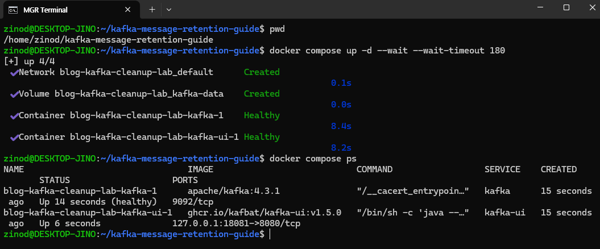
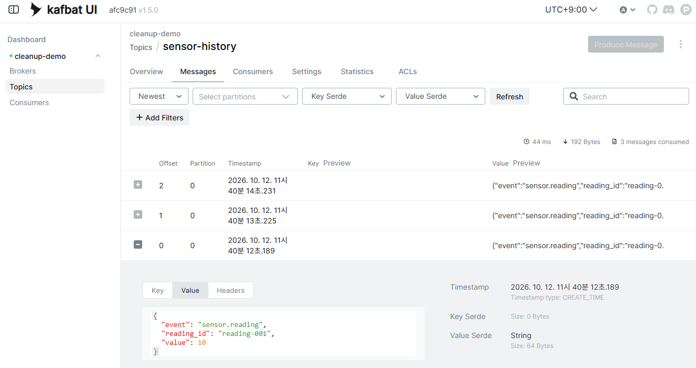
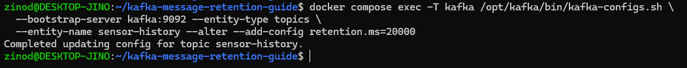
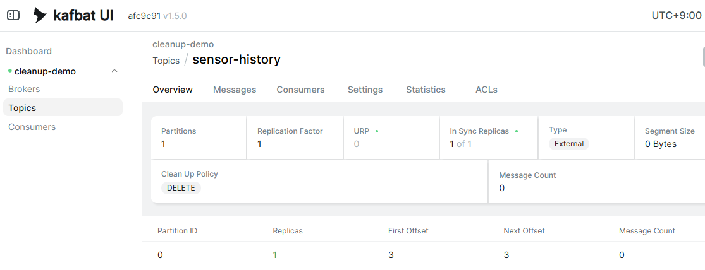
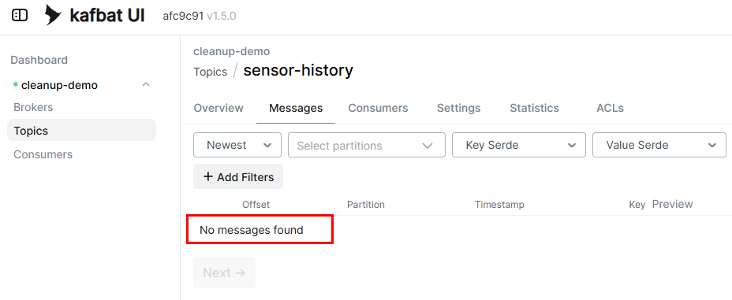

+++
title = 'Kafka 메시지는 언제 삭제될까? 읽기·commit·보관 기간의 차이'
date = '2026-10-12T00:00:00+09:00'
draft = false
slug = 'kafka-message-retention-guide'
description = 'Kafka 메시지는 소비자가 읽거나 commit했다고 바로 삭제되지 않는다. 메시지 3개를 발행하고 보관 기간을 줄여 실제 삭제 전·후를 확인하며, retention과 compaction의 차이를 간단히 정리한다.'
tags = ['kafka', 'retention', 'compaction', 'kafbat-ui', 'docker']
categories = ['IT개발']
showTableOfContents = true
+++

[Kafka offset 글](/posts/kafka-offset-vs-ibm-mq/)에서는 메시지를 읽고 commit해도 토픽의 데이터가 남는다고 설명했다. 그렇다면 그 데이터는 언제 삭제될까?

**기간 기반 삭제에서는 소비자의 처리 여부가 아니라, 토픽의 보관 기간과 용량 설정이 삭제를 결정한다.** 이번에는 메시지 3개를 발행하고 보관 기간을 1시간에서 20초로 줄여, UI에서 실제 삭제 전·후를 확인했다.

## 1. 읽기·commit·삭제는 다른 동작이다

| 동작 | 바뀌는 것 |
| --- | --- |
| 소비자가 읽음 | 실행 중 소비자의 읽기 위치가 진행됨 |
| 소비자가 offset을 commit | 그룹의 재개 위치가 저장됨 |
| 보관 정책으로 삭제 | 토픽에서 오래된 데이터를 더 이상 읽을 수 없게 됨 |

**모든 소비자가 읽을 때까지 Kafka가 메시지를 보관하는 것은 아니다.** 소비자가 아직 읽지 않았더라도 삭제 조건을 충족하면 데이터가 사라질 수 있다. 그룹마다 읽기 위치가 다르다는 것과, 토픽에 데이터가 남아 있다는 것은 별개의 조건이다. [Kafka 토픽 보관 설정](https://kafka.apache.org/43/configuration/topic-configs/)

읽기 위치와 commit의 상세 동작은 [Kafka offset 이해하기](/posts/kafka-offset-vs-ibm-mq/)를 참고한다. 이번 실습은 업무 소비자를 실행하지 않고 UI로 조회만 했다.

## 2. 기간과 용량으로 삭제하는 delete 정책

`cleanup.policy=delete`에서는 다음 설정으로 오래된 데이터의 삭제 기준을 정한다.

| 설정 | 의미 |
| --- | --- |
| `retention.ms` | 보관 기간, 밀리초 단위 |
| `retention.bytes` | 파티션별 보관 용량 제한, 바이트 단위 |

예를 들어 보관 기간을 7일로 설정해도 용량 제한이 함께 있으면, 데이터가 많이 쌓여 7일보다 먼저 오래된 데이터가 삭제될 수 있다. `retention.bytes`는 토픽 전체가 아니라 **파티션별 제한**이다.

삭제는 메시지 한 건마다 별도 타이머를 붙여 실행하는 방식이 아니다. Kafka는 데이터를 **로그 세그먼트라는 파일 단위**로 관리하고, 삭제 조건을 충족한 오래된 세그먼트를 정리한다. 따라서 보관 기간이 끝나는 순간 모든 메시지가 정확히 삭제된다고 해석하지 않는다. [Kafka delete 정책과 retention](https://kafka.apache.org/43/configuration/topic-configs/)

## 3. 메시지 3개를 넣고 삭제 전 확인

### 실행 파일 준비

Windows의 Docker Desktop과 WSL Ubuntu를 사용했다. 설치가 필요하면 [Docker Desktop 설치와 WSL 연동](/posts/docker-desktop-wsl-setup/)을 먼저 진행한다.

아래 두 파일을 다운로드해 같은 작업 디렉터리에 둔다.

- [compose.yaml](compose.yaml): Kafka 4.3.1과 Kafbat UI v1.5.0 실행 설정
- [history-initial.jsonl](history-initial.jsonl): 센서 측정값 테스트 메시지 3개

```text
kafka-message-retention-guide/
  compose.yaml
  history-initial.jsonl
```

이번 Compose 프로젝트 이름은 `blog-kafka-cleanup-lab`이다. 기존 Kafka UI·consumer group 실습과 별도 컨테이너와 데이터 볼륨을 사용하므로 이전 토픽은 변경하지 않는다. 단일 노드의 로컬 실습용 구성이며 운영 환경에 그대로 적용하지 않는다.

Docker Desktop을 켜고 작업 디렉터리의 **WSL Bash 터미널**에서 실행한다. 캡처에서는 `~/kafka-message-retention-guide`를 사용했다.

```bash
cd ~/kafka-message-retention-guide
docker compose up -d --wait --wait-timeout 180
docker compose ps
```



Windows 브라우저에서 **`http://localhost:18081/`**을 열면 `cleanup-demo` 클러스터가 표시된다. 이전 실습의 `18080`과 다른 포트다. UI는 읽기 전용으로 설정하고 `127.0.0.1`에만 연결했다. 로그인 없는 이 구성을 인터넷에 공개하지 않는다.

### 토픽 생성과 메시지 발행

첫 캡처를 여유 있게 찍을 수 있도록 처음에는 보관 기간을 **1시간**으로 설정한다.

```bash
docker compose exec -T kafka /opt/kafka/bin/kafka-topics.sh \
  --bootstrap-server kafka:9092 --create --topic sensor-history \
  --partitions 1 --replication-factor 1 \
  --config cleanup.policy=delete \
  --config retention.ms=3600000 \
  --config retention.bytes=-1 \
  --config segment.ms=5000 \
  --config file.delete.delay.ms=1000
```

용량 제한은 `retention.bytes=-1`로 두어 이번에는 기간에 따른 삭제만 확인한다. `segment.ms`와 파일 삭제 지연은 짧은 실습을 위한 값이다. 제공한 Compose에서도 삭제 점검 주기를 5초로 설정했다. 운영 권장값이 아니라, 작은 데이터로 결과를 오래 기다리지 않도록 구성한 것이다.

토픽이 이미 존재한다고 나오면 먼저 상태를 확인한다. 처음부터 다시 진행하려면 이후 명령의 토픽 이름을 모두 `sensor-history-02` 등으로 바꿔 기존 데이터와 구분한다.

`history-initial.jsonl`에는 실제 센서 정보가 아닌 다음 테스트 데이터를 넣었다.

```jsonl
{"event":"sensor.reading","reading_id":"reading-001","value":10}
{"event":"sensor.reading","reading_id":"reading-002","value":11}
{"event":"sensor.reading","reading_id":"reading-003","value":12}
```

다음 명령은 **한 번만** 실행한다. 반복 실행하면 메시지 3개가 추가된다.

```bash
docker compose exec -T kafka /opt/kafka/bin/kafka-console-producer.sh \
  --bootstrap-server kafka:9092 --topic sensor-history --sync \
  < history-initial.jsonl
```

UI에서 `Topics → sensor-history → Messages`를 열어 메시지를 조회한다.



캡처는 `Newest`로 조회해 최신순으로 표시됐다. 파티션은 하나이며, 메시지의 offset은 `0·1·2`였다. 첫 메시지의 상세 값에서도 `reading-001`, `value: 10`을 확인할 수 있었다.

## 4. 보관 기간을 줄이니 메시지가 사라졌다

삭제 전 화면을 확인한 뒤, 토픽의 보관 기간을 **20초**로 변경했다. 다음 명령은 기존 메시지도 삭제 대상에 포함시키므로 테스트 토픽에서만 실행한다.

```bash
docker compose exec -T kafka /opt/kafka/bin/kafka-configs.sh \
  --bootstrap-server kafka:9092 --entity-type topics \
  --entity-name sensor-history --alter --add-config retention.ms=20000
```



잠시 기다린 뒤 UI를 새로 조회한다. 독자가 재현할 때는 다음처럼 먼저 30초 정도 기다리고, 메시지가 남아 있으면 조금 더 기다려 확인하면 된다.

```bash
sleep 30
```

**설정을 바꾼 시점부터 정확히 20초 뒤 삭제된다는 뜻은 아니다.** 이미 저장된 데이터의 시간도 기준에 포함되고, 세그먼트 상태와 삭제 점검 주기에 따라 실제 시점이 달라진다. 이번 캡처로 정확한 삭제 소요 시간을 측정한 것은 아니다.

### Overview: 메시지 0개, 시작 위치와 끝 위치는 3



삭제 후 `Overview`에는 다음 값이 표시됐다.

| 항목 | 삭제 후 값 |
| --- | ---: |
| Message Count | 0 |
| First Offset | 3 |
| Next Offset | 3 |

이 토픽에서는 offset `0·1·2`에 있던 레코드가 사라지고, 읽을 데이터의 시작과 끝 위치가 모두 `3`이 됐다. **데이터가 삭제돼도 위치가 0으로 초기화되지는 않았다.** 이 값은 토픽의 위치이며 소비자 그룹의 committed offset을 조회한 결과는 아니다.

### Messages: 새 조회 결과도 비어 있음



`Messages`를 다시 조회해도 `No messages found`였다. 단순히 화면의 행을 숨긴 것이 아니라, 같은 토픽에서 이전 메시지를 더 이상 읽을 수 없는 상태임을 확인했다.

이번에는 업무 소비자를 실행하지 않았는데도 데이터가 삭제됐다. **업무 소비자의 수신이나 commit을 기다리는 것이 아니라, 토픽의 보관 정책이 적용된 결과**다. 이미 삭제된 메시지는 다른 그룹으로 읽거나 이전 offset을 지정한다고 복구되지 않는다.

실습을 끝낼 때는 같은 작업 디렉터리에서 이번 환경만 중지한다. 데이터 볼륨은 유지한다.

```bash
docker compose stop
```

## 5. Compaction은 무엇이 다를까?

`cleanup.policy=compact`는 기간 기준으로 오래된 데이터를 지우는 것과 달리, **같은 파티션 안에서 같은 key의 최신 값을 남기도록 과거 값을 정리**한다. 다른 파티션에 저장된 같은 key의 레코드까지 비교해 하나만 남기는 것은 아니다.

아래는 같은 파티션에 기록한 설명용 예시다. 이번 실습에서 compaction을 실행해 얻은 결과는 아니다.

| 같은 key에 기록한 순서 | key | value | 정리 후 |
| --- | --- | ---: | --- |
| 첫 번째 | sensor-A | 10 | 과거 값으로 제거 대상 |
| 두 번째 | sensor-A | 11 | 과거 값으로 제거 대상 |
| 세 번째 | sensor-A | 12 | 최신 값으로 유지 |

이 예시에서 최신 값은 기록 순서상 마지막 값이다. 값의 크기가 가장 큰 것을 선택한다는 뜻은 아니다. 정리도 발행 직후 즉시 수행되는 것은 아니며, 과거 값이 한동안 함께 조회될 수 있다. [Kafka log compaction](https://kafka.apache.org/43/design/design/)

센서의 모든 측정 이력을 일정 기간 조회해야 한다면 `delete` 정책의 보관 기간을 정하는 방식이 맞다. 반면 센서별 현재 상태를 구성하기 위해 최신 값이 필요하다면 `compact`를 검토할 수 있다. `compact,delete`로 두 정책을 함께 적용하는 구성도 가능하다. [Kafka cleanup.policy](https://kafka.apache.org/43/configuration/topic-configs/)

## 마무리

메시지 3개를 넣은 토픽에서 보관 기간을 줄였더니, UI의 메시지 개수가 0이 되고 새 조회에서도 데이터를 읽을 수 없었다. 소비자의 처리 여부와 데이터 보관은 별도로 관리된다는 점을 확인했다.

**commit은 그룹의 재개 위치를 저장하고, retention은 데이터를 얼마나 보관할지 정한다.** 재처리할 수 있어야 하는 기간을 기준으로 보관 설정을 정하되, 용량 제한이나 소비자의 처리 지연 때문에 필요한 데이터를 먼저 잃지 않는지도 함께 확인해야 한다.
